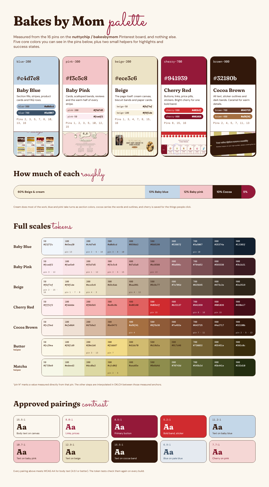

# Palette

> Step 1 of the board brief. Every value here was measured from the 16 pins on the [nuttychip / bakesbymom](https://in.pinterest.com/nuttychip/bakesbymom/) board, or interpolated between measured values. Nothing comes from outside the board.

## The five core colors

| | Name | Hero value | Token | Where it shows up on the board | Job in Bakes by Mom |
|---|---|---|---|---|---|
| 🩵 | **Baby Blue** | `#c4d7e8` | `blue-200` | Product and value cards ([02](./pins/02-pretty-ok-mail-club.md), [05](./pins/05-pretty-ok-studios-shop.md)), the fillings section ([16](./pins/16-sugarlace-bakery.md)), blue-and-white stripes ([07](./pins/07-croissant-lab-landing.md), [16](./pins/16-sugarlace-bakery.md)), dusty blue bands ([03](./pins/03-emily-jane-author.md), [08](./pins/08-digital-wave-taplink.md)) | Section fills, stripes, menu backdrop, FAQ rows, info states |
| 🩷 | **Baby Pink** | `#f3c5c8` | `pink-300` | How-it-works and FAQ cards ([02](./pins/02-pretty-ok-mail-club.md)), the scalloped loyalty band and review cards ([01](./pins/01-berloga-coffeeshop.md)), the candy-cart nav ([15](./pins/15-nectar-candy-cart.md)), whole pages ([12](./pins/12-september-sun-candles.md)) | Cards, scalloped bands, reviews, the warm half of a stripe |
| 🍪 | **Beige** | `#ece3c6` (band) · `#fbf7ef` (canvas) | `beige-200` · `beige-50` | The page background in 15 of 16 pins (all but [11](./pins/11-stevie-kay-showit.md)): Berloga cream `#f8f1de` ([01](./pins/01-berloga-coffeeshop.md)), Hopf Haus biscuit band `#ece3c6` ([04](./pins/04-hopf-haus-kitchen.md)), SugarLace `#faf6ea` ([16](./pins/16-sugarlace-bakery.md)), Nectar `#fbf7f1` ([15](./pins/15-nectar-candy-cart.md)) | The canvas, quiet bands, paper cards |
| 🍒 | **Cherry Red** | `#941939` (deep) · `#d02b2f` (bright) | `cherry-700` · `cherry-500` | Folder tabs, pricing buttons and stamp cards ([08](./pins/08-digital-wave-taplink.md)), category tiles and price pills ([16](./pins/16-sugarlace-bakery.md)), the candy-cart red band and buttons ([15](./pins/15-nectar-candy-cart.md)) | Buttons, links, prices, stickers. Bright cherry for one bold band per page |
| 🍫 | **Cocoa Brown** | `#32180b` (espresso) · `#a56f41` (caramel) | `brown-900` · `brown-400` | Dark cards and ribbons ([02](./pins/02-pretty-ok-mail-club.md), [05](./pins/05-pretty-ok-studios-shop.md)), display type ([07](./pins/07-croissant-lab-landing.md)), outlines and offset shadows ([01](./pins/01-berloga-coffeeshop.md)), the caramel nav and footer ([04](./pins/04-hopf-haus-kitchen.md)), the author footer ([03](./pins/03-emily-jane-author.md)) | All text, sticker outlines, dark bands; caramel for warm details |

### Two helpers

They appear on the board but play supporting roles, so they never lead a layout.

| Name | Value | Token | From | Use only for |
|---|---|---|---|---|
| **Butter** | `#f0e1b6` | `butter-200` | Floral newsletter band ([03](./pins/03-emily-jane-author.md)), nav and about panel ([13](./pins/13-puzzle-pantry.md)), ribbon `#f2db87` ([07](./pins/07-croissant-lab-landing.md)) | Highlights, a sunny section, warning states |
| **Matcha** | `#cfc06f` | `matcha-300` | Stripes and value card ([02](./pins/02-pretty-ok-mail-club.md), [05](./pins/05-pretty-ok-studios-shop.md)) | Success states, a matcha flavor tag |

### Left out on purpose

Some pins lean on colors that aren't part of your mix, so the system doesn't carry them: the orange of [07](./pins/07-croissant-lab-landing.md), the forest green of [06](./pins/06-lilli-pilli-patisserie.md), the lavender of [15](./pins/15-nectar-candy-cart.md) and the peach of [06](./pins/06-lilli-pilli-patisserie.md). We still borrow those pins' layouts and components, just recolored.

## How much of each

| Share | Color | What it covers |
|---|---|---|
| ~60% | Beige and cream | Canvas, paper cards, quiet bands |
| ~13% | Baby blue | One or two section fills per page, stripes |
| ~12% | Baby pink | Cards, scalloped bands, reviews |
| ~10% | Cocoa brown | Text, outlines, one dark ribbon or footer |
| ~5% | Cherry red | Buttons, links, prices, stickers |

The board backs this up: cream or beige is the page background in 15 of the 16 pins, blue and pink arrive as whole sections or cards, and where cherry appears it's mostly buttons, tabs, prices and a single bold band.

## Full scales

Steps marked ★ were measured directly from a pin. The rest are interpolated in OKLCH between the measured anchors, so each scale gets darker smoothly without drifting in hue.

| Step | Baby Blue | Baby Pink | Beige | Cherry Red | Cocoa Brown | Butter | Matcha |
|---|---|---|---|---|---|---|---|
| 50 | `#f2f7fc` | `#fcedf2` ★ 03 | `#fbf7ef` ★ 02·15·16 | `#fff1f2` | `#fcf3ed` | `#fcf9ea` | `#f7f8e9` |
| 100 | `#e5eaf0` ★ 13 | `#fae5e9` | `#f8f1de` ★ 01 | `#fdddde` | `#efe0d4` | `#f8f1d9` | `#edeed2` |
| 200 | **`#c4d7e8`** ★ 02·05·16 | `#f5d7d5` ★ 01 | **`#ece3c6`** ★ 04 | `#f6b5b5` | `#d7b9a2` | **`#f0e1b6`** ★ 03·13 | `#dcd8a2` |
| 300 | `#a0b6cd` ★ 03·08 | **`#f3c5c8`** ★ 02·05 | `#d3c6ab` | `#ed8c8b` | `#be9472` | `#f2db87` ★ 07 | **`#cfc06f`** ★ 02·05 |
| 400 | `#859bb2` | `#d7a5a8` | `#baa991` ★ 04·12 | `#e06160` | `#a56f41` ★ 04 | `#d1bb70` | `#aea65e` |
| 500 | `#6b8199` | `#bc8588` ★ 13 | `#9c8c77` | **`#d02b2f`** ★ 15 | `#8f5b38` | `#b19b5a` | `#8e8d4d` |
| 600 | `#52687f` | `#9a686c` | `#7e705d` | `#b22137` | `#7a492e` | `#917d46` | `#70743d` |
| 700 | `#3a5067` ★ 10 | `#794d52` | `#625645` | **`#941939`** ★ 08 | `#643725` ★ 07·11 | `#736032` | `#545b2d` |
| 800 | `#25374a` | `#593338` | `#473c2e` | `#801026` ★ 15 | `#4a2717` | `#55451e` | `#3b441e` |
| 900 | `#12202f` | `#3b1b21` | `#2e2519` | `#430e17` | **`#32180b`** ★ 02 | `#392c0c` | `#232d10` |

Plus one neutral: **Paper** `#fffdf6`, the warm white of the product cards in [15](./pins/15-nectar-candy-cart.md) and [16](./pins/16-sugarlace-bakery.md).

## Roles

These become the semantic tokens in [`packages/tokens`](../../packages/tokens). Components use roles, never raw steps.

| Role | Token | Value |
|---|---|---|
| Page canvas | `color.bg.canvas` | beige-50 `#fbf7ef` |
| Card surface | `color.bg.surface` | paper `#fffdf6` |
| Quiet band | `color.bg.sunken` | beige-100 `#f8f1de` |
| Biscuit band | `color.bg.beige` | beige-200 `#ece3c6` |
| Blue band | `color.bg.blue` | blue-200 `#c4d7e8` |
| Pink band | `color.bg.pink` | pink-200 `#f5d7d5` |
| Bold band (once per page) | `color.bg.brand` | cherry-500 `#d02b2f` |
| Dark band, footer | `color.bg.inverse` | brown-900 `#32180b` |
| Text | `color.text.primary` | brown-900 `#32180b` |
| Supporting text | `color.text.secondary` | brown-700 `#643725` |
| Muted text | `color.text.muted` | brown-600 `#7a492e` |
| Brand text, links, prices | `color.text.brand` | cherry-700 `#941939` |
| Primary button | `color.action.primary` | cherry-700 `#941939`, hover cherry-800 `#801026` |
| Outline (cards, stickers) | `color.border.default` | brown-900 `#32180b` |
| Hairline | `color.border.subtle` | beige-300 `#d3c6ab` |
| Focus ring | `color.border.focus` | blue-700 `#3a5067` |
| Success / warning / error / info | `color.status.*` | matcha / butter / cherry / blue |

## Approved pairings

Checked against WCAG 2.2. Normal text needs 4.5:1, large text and UI parts need 3:1. The token tests re-check these on every build.

| Text | Background | Ratio | Use |
|---|---|---|---|
| Cocoa `#32180b` | Canvas `#fbf7ef` | 15.5:1 | Body copy |
| Cherry `#941939` | Canvas `#fbf7ef` | 8.0:1 | Links, prices, script accents |
| White | Cherry `#941939` | 8.6:1 | Primary button |
| White | Bright cherry `#d02b2f` | 5.2:1 | Bold band, stickers |
| Cocoa | Baby blue `#c4d7e8` | 11.2:1 | Text on blue sections |
| Cocoa | Baby pink `#f3c5c8` | 10.7:1 | Text on pink cards |
| Cocoa | Beige `#ece3c6` | 12.9:1 | Text on biscuit bands |
| Canvas | Cocoa `#32180b` | 15.5:1 | Footer, dark ribbons |
| Blue `#3a5067` | Pale blue `#e5eaf0` | 6.9:1 | Info notes |
| Deep cherry `#801026` | Pink `#f5d7d5` | 7.7:1 | Cherry text on pink |

## Don'ts

- Don't put cherry text on baby blue below 18px. It reads, but it vibrates; use cocoa.
- Don't use bright cherry `#d02b2f` for small text on cream. Keep it for fills with white text.
- Don't stack blue and pink sections back to back without a beige band or an edge between them.
- Don't introduce orange, green or lavender as brand colors. Matcha and butter stay as helpers.
