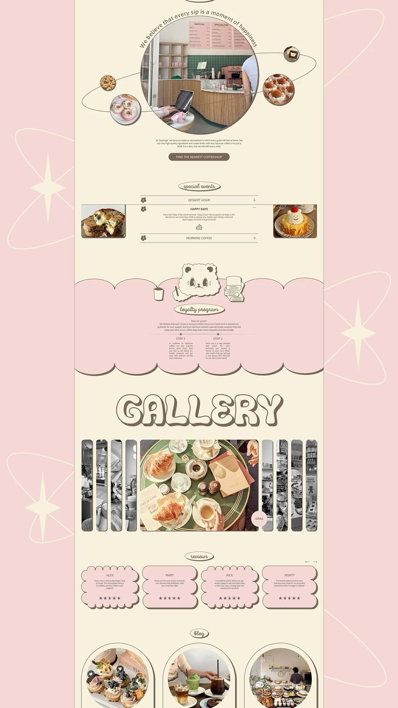

# 01 · Berloga Coffeeshop

| | |
|---|---|
| Pin | [pinterest.com/pin/586101339056167926](https://www.pinterest.com/pin/586101339056167926/) |
| Original | [Behance: Berloga Coffeeshop, corporate website](https://www.behance.net/gallery/222348583/Bearloga-Coffeeshop) |
| What it is | A long café homepage in cream and baby pink, outlined in brown, with a bear mascot |
| Image | [`pinterest/board/01-berloga-coffeeshop.jpg`](../../../pinterest/board/01-berloga-coffeeshop.jpg) |
| Picked for | **Gallery** (primary), **Reviews** (primary), **Bake Club / loyalty** (primary), Our-story orbit, Journal |

View the pin

## Layout

- **Frame.** A single centered column, about 62% of the presentation width, on a cream page. Sections are separated by generous space (roughly one and a half section titles of air) instead of rules.
- **Grid.** Mostly centered, symmetrical compositions. The only multi-column rows are reviews (4 up), blog (3 up) and the loyalty steps (2 up).
- **Section titles.** Every section opens with the same device: a short word in handwritten script inside an outlined oval pill (`special events`, `loyalty program`, `reviews`, `blog`). The one exception is `GALLERY`, set huge in a bubbly outlined face.
- **Line.** Everything is drawn with one brown line weight (about 1.5px at the comp's scale), plus a hard offset shadow on cards. No blur shadows anywhere.

## Sections, top to bottom

| # | Section | Layout | Components | Colors |
|---|---|---|---|---|
| 1 | Our story | Centered: a large circle photo (about 45% of column width) with a sentence set on an arc above it; a thin elliptical orbit line passes behind with 5 small circle photos of different sizes on it; short centered paragraph; one pill button | Orbit showcase, arc text, pill button | Cream page, taupe-brown line, brown button |
| 2 | Special events | Oval script label, then an accordion of 3 rows split by hairlines. The open row is flanked by two outlined photos, one each side | Pill label, accordion with flower-shaped number bullets, side photos | Cream, brown hairlines |
| 3 | Loyalty program | Full-width pink band with scalloped top and bottom edges outlined in brown. The bear mascot sits on the top edge between a cup and a notebook doodle. Letter-style copy ("Dear our guests!"), then 2 steps in columns with star bullets | Scalloped band, mascot sticker, doodles, 2-step list | Baby pink `#f5d7d5`, brown outline |
| 4 | Gallery | `GALLERY` in a huge bubbly outlined face with a brown offset shadow. Below, an accordion strip gallery: about 9 tall rounded strips; the active one is wide (about 45%) and in color, the others are narrow and greyscale. A small pink circle chip says `DRAG` | Bubble title, strip gallery, drag chip | Cream, brown, pink chip |
| 5 | Reviews | Oval label, arrows top-right, 4 cards in a row. Each card has a wavy (scalloped) outline, brown offset shadow, name in caps, a 3-line quote and 5 stars | Scalloped review card, carousel arrows | Baby pink cards, brown outline |
| 6 | Blog | Oval label, 3 arch-shaped frames (outline plus offset shadow) holding round-topped photos | Arch card | Cream, brown |

The presentation background (pink with cream sparkles and orbit rings) repeats the orbit motif from section 1.

## Components

### Orbit showcase (section 1)
- **Anatomy.** A center circle image; a sentence on an arc hugging the top of the circle; an ellipse (stroke only) crossing behind the circle at a slight tilt; 4 to 6 small circle images sitting on the ellipse, each with a brown outline.
- **Proportions.** Satellites are 10–20% of the center circle's diameter and deliberately uneven in size.
- **Bakes by Mom.** `Orbit` component: center photo of Mom's kitchen, satellites of bakes, the arc text "Every bake is a little bit of home". Static by default; a slow drift along the ellipse is allowed only without `prefers-reduced-motion`.

### Script pill label
- An outlined oval (about 3× wider than tall) with one handwritten lowercase word inside. Used as every section's eyebrow.
- **Bakes by Mom.** `SectionHeading eyebrowStyle="pill"` with the hand script font.

### Accordion with side photos (section 2)
- Rows split by hairlines, number bullets in a flower-shaped badge, title in italic caps, plus or minus on the right. When a row opens, its photos appear at both sides of the list.
- **Bakes by Mom.** `Accordion` rows variant for "This week's specials"; side photos are optional decoration and hidden below tablet width.

### Scalloped band with mascot (section 3)
- Scallops on both edges, each scallop outlined. The mascot overlaps the top edge, so the band reads as a stage.
- **Bakes by Mom.** `EdgeDivider shape="scallop" outline` above and below a pink section; Mom's wooden-spoon or cupcake doodle can sit on the edge.

### Bubble title (section 4)
- Rounded, chunky letters; cream fill; 2px brown outline; a 4–5px brown offset shadow down-right.
- **Bakes by Mom.** `SectionHeading variant="bubble"` using the bubble display font. One per page.

### Strip gallery (section 4)
- A row of tall rounded strips. One is open and in color, the rest are narrow and greyscale. Dragging or clicking opens a different strip.
- **Bakes by Mom.** `Gallery variant="strips"`: buttons for each strip (keyboard and screen reader friendly), `aria-expanded` on the open one, greyscale removed on hover and focus. Below tablet width it becomes a horizontal scroll-snap row with the drag chip.

### Scalloped review card (section 5)
- Wavy outline all round, brown offset shadow, centered name in small caps, quote, stars at the bottom.
- **Bakes by Mom.** `ReviewCard` with the scalloped shape; stars are spoken as "Rated 5 out of 5".

### Arch card (section 6)
- Tall arch frame with outline and offset shadow; the photo inside is also arch-topped.
- **Bakes by Mom.** `ProductCard imageShape="arch"` for journal posts and recipes.

## Colors measured

| Swatch | Hex | Where | Bakes by Mom token |
|---|---|---|---|
| Baby pink | `#f5d7d5` | Loyalty band, review cards, page surround | `pink-200` |
| Cream | `#f8f1de` | Page | `beige-100` |
| Taupe brown | `#776d5f` / `#5c4f40` | Lines, outlines, type | Replaced by `brown-900` cocoa (warmer, more contrast) |
| Button brown | `#7a6758` | Pill button | Replaced by `cherry-700` for the main action |

## Type

| Role in the pin | Look | Bakes by Mom font |
|---|---|---|
| `GALLERY` | Bubbly, rounded, outlined | Bubble display (Cherry Bomb One) |
| Section pills | Handwritten script | Hand (Caveat) |
| Row titles | Italic small caps sans | DM Sans, uppercase, tracked |
| Body | Small humanist sans | DM Sans |

## Take

- The strip gallery, exactly as a pattern.
- Scalloped review cards with offset shadows.
- The pink scalloped band as the Bake Club section.
- Script pill labels as section eyebrows.
- The orbit for "Our story".

## Leave

- The grey-taupe brown. Cocoa reads warmer and gives more contrast.
- Body text at the comp's tiny size. Nothing under 16px for reading copy.
- Greyscale as the only "inactive" signal in the gallery. The open strip also gets width and an `aria-expanded` state.
