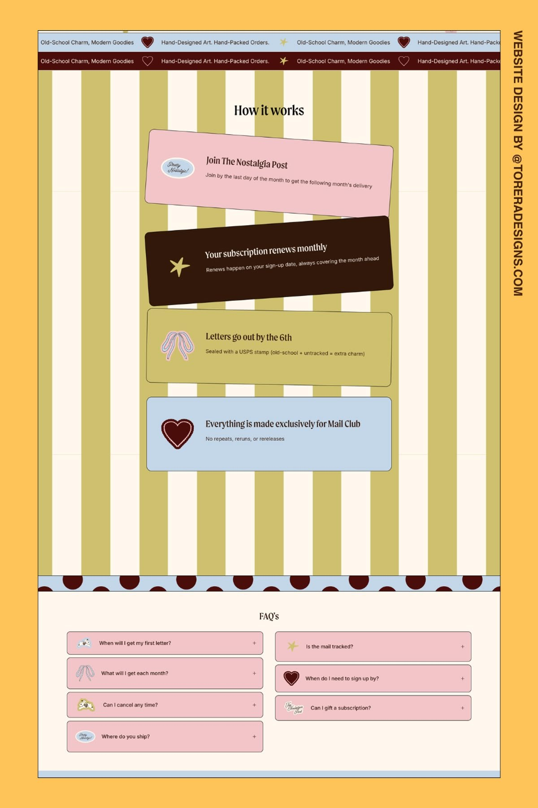

# 02 · Pretty OK Studios, Nostalgia Post mail club

| | |
|---|---|
| Pin | [pinterest.com/pin/586101339056167850](https://www.pinterest.com/pin/586101339056167850/) |
| Original | [Torera Designs: Pretty OK Studios](https://toreradesigns.com/project-prettyokstudios) |
| What it is | The "How it works" and FAQ part of a snail-mail subscription page, on wide stripes |
| Image | [`pinterest/board/02-pretty-ok-mail-club.jpg`](../../../pinterest/board/02-pretty-ok-mail-club.jpg) |
| Picked for | **Process / how to order** (primary), **FAQ** (primary), **Marquee** (primary) |

View the pin

## Layout

- **Frame.** Full-width sections inside a thin dark keyline, set on a wide vertical stripe (olive and cream, each stripe about 5% of the width).
- **Grid.** Process cards sit in one centered column about half the page wide. The FAQ uses two equal columns.
- **Rhythm.** Ribbons and borders do the separating: double marquee at the top, half-dot border between the stripes and the FAQ, a plain blue strip at the bottom.

## Sections, top to bottom

| # | Section | Layout | Components | Colors |
|---|---|---|---|---|
| 1 | Double marquee | Two stacked ribbons running edge to edge: blue with dark text, espresso with cream text. Sentence-case copy separated by a heart and a star | Marquee (double) | Baby blue `#c4d7e8`, espresso `#32180b` |
| 2 | How it works | Serif title centered on the stripes. 4 stacked cards, each rotated a little (about −3°, +2°, 0°, 0°), overlapping slightly. Each card: sticker icon on the left, serif title, one sans line | Step cards (tilted stack), sticker icons | Pink `#f3c5c8`, espresso, olive `#cfc06f`, blue `#c4d7e8` |
| 3 | Half-dot border | A blue strip with espresso half circles along its top edge, like a scalloped trim | Edge divider (half dots) | Blue, dots `#4a0d0b` |
| 4 | FAQ | Centered serif title `FAQ's`. Two columns of pink rows, each outlined, with a sticker icon, the question and a plus sign | Accordion (two-column, sticker icons) | Pink `#f2c5c8`, cream `#fff7ee` |
| 5 | Bottom strip | Plain blue band | — | Blue |

## Components

### Tilted step stack (section 2)
- **Anatomy.** Full-width cards with a 1px dark outline and about 12px radius; icon sticker on the left (about 15% of card width); title in serif; one sentence below.
- **Rhythm.** Each card is a different flavor color; rotation alternates so the stack looks hand-placed; cards overlap by a few pixels.
- **Bakes by Mom.** `StepList variant="stack"` for "How to order": 1 Pick your bake · 2 Choose a date · 3 Pick up warm · 4 Share a slice. Rotation turns off under `prefers-reduced-motion` only if it animates; static tilt is fine.

### Double marquee (section 1)
- Two ribbons with opposite colors. Copy is short claims with icon separators.
- **Bakes by Mom.** `Marquee` with two rows (blue and cocoa), copy like "Baked this morning ♥ Made in Mom's kitchen ★". Pause button and a static list for screen readers, as in the existing component.

### Half-dot border (section 3)
- Semicircles sitting on a strip, evenly spaced, in a dark color on a light strip.
- **Bakes by Mom.** `EdgeDivider shape="dots"`.

### Two-column FAQ (section 4)
- Each row is its own outlined card with a sticker on the left. Plus on the right becomes minus when open.
- **Bakes by Mom.** `Accordion variant="cards" columns={2}` with small doodles as row icons. Each column stacks independently.

## Colors measured

| Swatch | Hex | Where | Bakes by Mom token |
|---|---|---|---|
| Baby pink | `#f3c5c8` | Step card, FAQ rows | `pink-300` |
| Baby blue | `#c4d7e8` | Step card, marquee, strips | `blue-200` |
| Espresso | `#32180b` | Step card, marquee | `brown-900` |
| Matcha | `#cfc06f` | Stripes, step card | `matcha-300` |
| Cream | `#fff7ee` | Stripes, FAQ ground | `beige-50` |
| Oxblood dot | `#4a0d0b` | Half-dot border | `brown-900` |

## Type

| Role in the pin | Look | Bakes by Mom font |
|---|---|---|
| Titles | Narrow, soft serif | Fraunces |
| Body, questions, marquee | Neutral sans | DM Sans |

## Take

- The tilted, multi-colored step stack. It's the friendliest "how it works" on the board.
- Two-column FAQ cards with sticker icons.
- The double ribbon at the top of a section.

## Leave

- Olive as a dominant stripe. In Bakes by Mom the stripe partner is baby blue or pink; matcha stays a helper.
- Rotations above 3°. Text on tilted cards gets hard to read beyond that.
