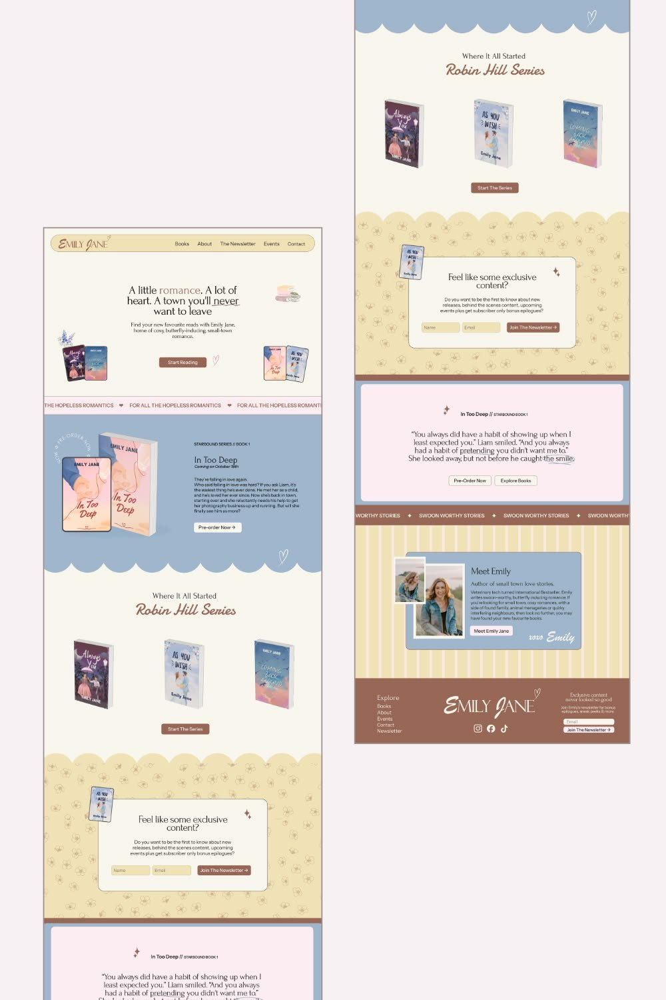

# 03 · Emily Jane, romance author

| | |
|---|---|
| Pin | [pinterest.com/pin/586101339056167848](https://www.pinterest.com/pin/586101339056167848/) |
| Original | [Tiny Stack: services](https://tinystack.co.uk/services) |
| What it is | A cosy author homepage in dusty blue, butter, blush and brown |
| Image | [`pinterest/board/03-emily-jane-author.jpg`](../../../pinterest/board/03-emily-jane-author.jpg) |
| Picked for | **Newsletter** (primary), **Footer** (primary), mobile nav capsule, rotating seal, "Meet" card |

View the pin

## Layout

- **Frame.** Two long phone-proportioned page captures side by side. The page is a single centered column with full-bleed color bands.
- **Grid.** Hero and series are centered. The featured book and "Meet Emily" are two-column splits (image left, text right).
- **Rhythm.** Every color change is marked by a scalloped edge or a ribbon. The page alternates cream, blue, cream, butter, blue, butter stripes, brown.

## Sections, top to bottom

| # | Section | Layout | Components | Colors |
|---|---|---|---|---|
| 1 | Nav | Rounded capsule floating inside the page margin: script wordmark left, 5 links right | Capsule nav | Butter `#f0e1b6`, outline |
| 2 | Hero | Centered 3-line headline mixing serif with one colored word and a hand-underlined word; subline; brown pill CTA; book stacks and a cup doodle placed in the corners | Headline with hand underline, pill button, corner props | Cream `#f9f6ed`, brown `#8f6559` |
| 3 | Ribbon | Thin pink marquee: "FOR ALL THE HOPELESS ROMANTICS ♥" | Marquee | Blush pink |
| 4 | Featured release | Dusty blue band. Left: phone and book mockups with a rotating ring-text seal ("pre-order now"). Right: series label, title, date, body, white pill CTA. Bottom edge is scalloped | Seal with ring text, scalloped edge | Dusty blue `#a0b6cd` |
| 5 | Series | Small sans line + big brush script title, 3 books in a row, one CTA | Script title, product row | Cream |
| 6 | Newsletter | Butter floral pattern with a scalloped top edge. Centered cream card with outline: a book sticker tilted over its corner, sparkle doodle, title, one paragraph, name and email inputs plus button in one row | Newsletter card, floral pattern, tilted sticker | Butter `#f0e1b6`, cream card |
| 7 | Quote | Blush card inside a dusty blue frame: sparkle, small label, a quote with a hand-drawn underline, 2 small buttons | Quote card | Blush `#fcedf2`, blue |
| 8 | Ribbon | Brown marquee: "SWOON WORTHY STORIES ✦" | Marquee | Brown |
| 9 | Meet Emily | Butter vertical stripes. Blue card: two overlapping photos with white borders on the left, name, one-line role, bio, small button, script sign-off "xoxo Emily" | About card, photo stack, signature | Butter stripes, dusty blue |
| 10 | Footer | Brown band, 3 columns: Explore links, centered script logo with social icons, a small newsletter form | Footer | Brown `#986858` |

## Components

### Capsule nav (section 1)
- A pill-shaped bar inset from the page edge, with an outline, the wordmark left and links right.
- **Bakes by Mom.** `SiteHeader variant="capsule"`, used as the mobile and scrolled state of the main nav.

### Rotating ring seal (section 4)
- Circle of uppercase text around a small icon, slowly turning, overlapping the image's corner.
- **Bakes by Mom.** `Seal spin` with "fresh this morning • fresh this morning •". Spinning stops under reduced motion.

### Newsletter card (section 6)
- Patterned band + centered paper card + one tilted sticker on the card's corner + inline form.
- **Bakes by Mom.** `NewsletterSignup variant="card"` over `PatternSurface pattern="dots"` on butter or pink, with the Bake Club sticker on the corner.

### Meet card with photo stack and signature (section 9)
- Two photos overlapping with thick white borders; text beside; signature in script.
- **Bakes by Mom.** Alternative to the main About pick ([05](./05-pretty-ok-studios-shop.md)); the script sign-off "with love, Mom" is borrowed for every About variant.

### Footer (section 10)
- Three columns on a brown band: links, centered logo and socials, mini newsletter.
- **Bakes by Mom.** `SiteFooter` layout: logo center column, links left, newsletter right, cocoa band.

## Colors measured

| Swatch | Hex | Where | Bakes by Mom token |
|---|---|---|---|
| Dusty blue | `#a0b6cd` | Featured band, quote frame, Meet card | `blue-300` |
| Butter | `#f0e1b6` | Nav, floral band, stripes | `butter-200` |
| Brown | `#8f6559` / `#986858` | Buttons, footer | `brown-500` area; footer uses `brown-900` for contrast |
| Blush | `#fcedf2` | Quote card | `pink-50` |
| Cream | `#f9f6ed` | Page | `beige-50` |

## Type

| Role in the pin | Look | Bakes by Mom font |
|---|---|---|
| Headline | Light serif with one colored word | Fraunces |
| Series titles, logo | Brush and monoline script | Pinyon Script for big words, Caveat for notes |
| Body, links | Clean sans | DM Sans |

## Take

- The newsletter card on a pattern with a tilted sticker.
- The 3-column brown footer.
- The capsule nav for mobile.
- A ring-text seal on a featured item.
- Signing the About section in script.

## Leave

- Light-weight body text on dusty blue. Use cocoa text at 400+ weight on blue.
- Small low-contrast footer text; use canvas color on cocoa.
