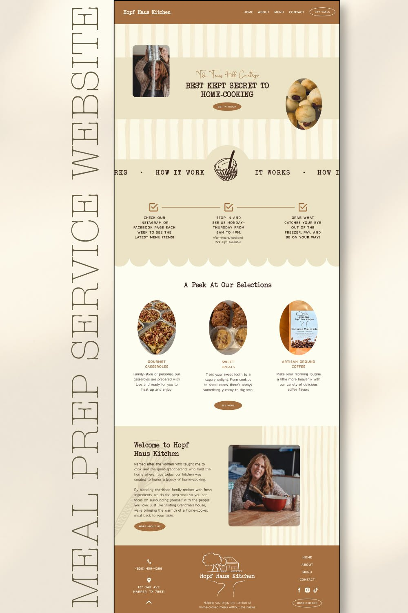

# 04 · Hopf Haus Kitchen, meal prep

| | |
|---|---|
| Pin | [pinterest.com/pin/586101339056167790](https://www.pinterest.com/pin/586101339056167790/) |
| Original | [Rae Creative Co.](http://raecreativeco.net/) |
| What it is | A home-cooking business site in caramel, beige and cream, with a typewriter voice |
| Image | [`pinterest/board/04-hopf-haus-kitchen.jpg`](../../../pinterest/board/04-hopf-haus-kitchen.jpg) |
| Picked for | Process (alternate: checkbox row), oval product photos, welcome split, footer (alternate) |

View the pin

## Layout

- **Frame.** One desktop page at about 55% of the presentation width, centered, with a vertical "MEAL PREP SERVICE WEBSITE" label beside it.
- **Grid.** Hero and welcome are asymmetric splits; steps and selections are 3 equal columns.
- **Rhythm.** Hand-drawn vertical stripes (uneven, like a brush) frame the hero band. A scalloped edge ends the beige "How it works" area.

## Sections, top to bottom

| # | Section | Layout | Components | Colors |
|---|---|---|---|---|
| 1 | Nav | Solid caramel bar: serif logo left in cream, caps links right, an outlined pill "Gift cards" | Bar nav, outline pill | Caramel `#a56f41` |
| 2 | Hero | Brushy cream/beige stripes top and bottom, a solid beige band across the middle. Rounded photo left, oval photo right breaking out of the band, centered text: a handwritten line, a 2-line typewriter slab headline, a caramel pill CTA | Stripe-framed band, oval photo, pill button | Beige `#ece3c6`, caramel |
| 3 | How it works ribbon | Ribbon of typewriter caps "HOW IT WORKS •" with a bowl illustration sitting in an arch bump in the middle | Marquee with center badge | Beige |
| 4 | Steps | 3 columns. Each has a checkbox icon; a line connects the icons; caps text below | Step row with connector | Caramel icons, cocoa text |
| 5 | Scallop | Beige ends in a scalloped edge onto cream | Edge divider | Beige to cream |
| 6 | Selections | Typewriter title, 3 tall oval photos, caramel caps names, short text, one CTA | Oval product card | Cream `#fdfdf1` |
| 7 | Welcome | Split: beige left (typewriter title, 2 paragraphs, caramel CTA) with a faint wheat drawing; photo right on brushy stripes | Split about | Beige, cream stripes |
| 8 | Footer | Caramel band, 3 columns: phone and address with icons, centered line-drawing logo, nav links + socials + outline pill | Footer | Caramel |

## Components

### Checkbox step row (section 4)
- Three steps in a line, each with a ticked checkbox, joined by a horizontal rule that runs between the icons.
- **Bakes by Mom.** `StepList variant="row"`; becomes a vertical list with the line on the left below tablet width.

### Ribbon with a center badge (section 3)
- A text ribbon with a circular or arched bump in the middle holding an illustration.
- **Bakes by Mom.** `Marquee` with a `badge` slot (a doodle in a beige arch), used above the process section.

### Oval product photo (section 6)
- Tall ovals, roughly 2:3, no frame, caps name in an accent color.
- **Bakes by Mom.** `ProductCard imageShape="oval"` for the "A peek at the menu" teaser.

### Welcome split (section 7)
- Text on a solid band beside a photo that sits on a different texture.
- **Bakes by Mom.** Alternate About layout ("Welcome to Mom's kitchen").

## Colors measured

| Swatch | Hex | Where | Bakes by Mom token |
|---|---|---|---|
| Caramel | `#a56f41` | Nav, footer, buttons, step icons | `brown-400` (anchor) |
| Beige | `#ece3c6` | Hero band, how-it-works area, welcome | `beige-200` (anchor) |
| Cream | `#fdfdf1` | Page | `beige-50` |
| Sand | `#baa991` | Stripe texture | `beige-400` (anchor) |

## Type

| Role in the pin | Look | Bakes by Mom font |
|---|---|---|
| Headlines | Typewriter slab caps | Not carried over; Fraunces covers headlines |
| Kicker | Handwritten line | Caveat |
| Labels | Small caps sans | DM Sans uppercase |

## Take

- The connected checkbox row as a compact process alternative.
- Oval product photos.
- Caramel as a warm detail color (`brown-400`).
- A ribbon with a doodle in the middle.

## Leave

- A caramel nav and footer as large fills: caramel with white text is under 4.5:1. Bakes by Mom uses cocoa for dark bands.
- The typewriter face; it fights with the serif display.
