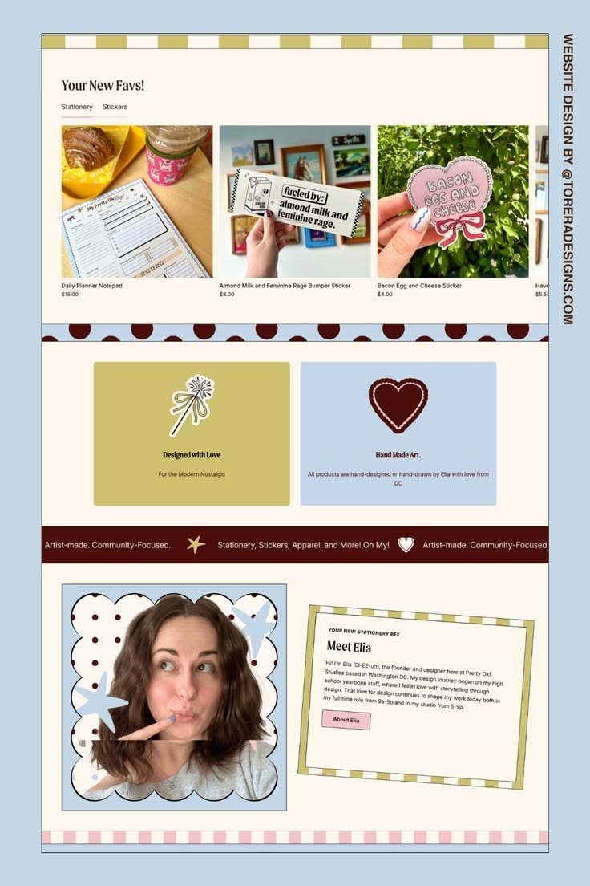

# 05 · Pretty OK Studios, shop homepage

| | |
|---|---|
| Pin | [pinterest.com/pin/586101339056167781](https://www.pinterest.com/pin/586101339056167781/) |
| Original | [Instagram: @fylona.by](https://www.instagram.com/fylona.by/) (design by Torera Designs) |
| What it is | The product row, values and founder section of a stationery shop |
| Image | [`pinterest/board/05-pretty-ok-studios-shop.jpg`](../../../pinterest/board/05-pretty-ok-studios-shop.jpg) |
| Picked for | **About / Meet Mom** (primary), value cards, product row with tabs (Menu alternate) |

View the pin

## Layout

- **Frame.** A desktop page inside a dark keyline on a baby-blue presentation ground. The same family as [02](./02-pretty-ok-mail-club.md).
- **Grid.** Product row is 4 up with the 4th card cut off (it scrolls). Values are 2 equal cards. Founder section is a 50/50 split.
- **Rhythm.** Patterned strips separate everything: an olive checker strip at the top, a half-dot border, an espresso ribbon and a pink checker strip at the bottom.

## Sections, top to bottom

| # | Section | Layout | Components | Colors |
|---|---|---|---|---|
| 1 | Checker strip | Olive and cream blocks along the top | Edge divider (checker) | Matcha `#cfc06f` |
| 2 | Your New Favs! | Serif title left, 2 tabs under it (`Stationery`, `Stickers`; the active one underlined in pink). Product row: square photos, name and price below, the last card peeking | Tabs, product carousel | Cream `#fff6ec` |
| 3 | Half-dot border | Espresso half circles on a blue strip | Edge divider (dots) | Blue `#c4d7e8`, espresso |
| 4 | Values | Two cards side by side (olive and blue), each with a centered sticker icon, serif title and one line | Value card | Matcha, baby blue |
| 5 | Ribbon | Espresso marquee with cream text and star and heart icons | Marquee | Espresso `#3c190d` |
| 6 | Meet Elia | Left: photo in a scalloped frame, sitting on a blue polka-dot square with big star doodles. Right: a card tilted about −3° with a matcha/cream striped border; eyebrow caps, serif title, bio, pink outline button | Scalloped photo frame, polka-dot pattern, tilted note card with striped border | Blue, matcha stripes, pink button |
| 7 | Checker strip | Pink and cream blocks | Edge divider (checker) | Pink |

## Components

### Meet section: scalloped frame + tilted note (section 6)
- **Photo.** A rounded square with a scalloped edge all round, outlined, on a polka-dot ground that's bigger than the photo. Two oversized star doodles overlap the photo's corners.
- **Note.** A paper card tilted a few degrees with a thick striped border (like candy-stripe ribbon), eyebrow in small caps ("YOUR NEW STATIONERY BFF"), serif title, 4–5 lines of bio, a small outlined button.
- **Bakes by Mom.** The About section: "Meet Mom" with Mom's photo in `Polaroid frame="scallop"` on `PatternSurface pattern="dots"` in blue, and a `Card frame="stripes"` tilted −2° with eyebrow "THE BAKER BEHIND IT ALL", title "Hi, I'm Mom", bio, signature, "Read our story" button.

### Value cards (section 4)
- Equal cards, solid flavor fills, one sticker icon centered at the top, 2 lines of text.
- **Bakes by Mom.** "Made from scratch" (whisk doodle, blue) and "Real butter, real eggs" (heart, pink). Use `Card tone`.

### Product row with tabs (section 2)
- Title and tabs left-aligned above a horizontally scrolling row.
- **Bakes by Mom.** `FilterChips` + `ProductCard` row for "This week's favorites", tabs `Cakes · Cookies · Breads`.

## Colors measured

| Swatch | Hex | Where | Bakes by Mom token |
|---|---|---|---|
| Baby blue | `#c4d6ea` | Value card, polka-dot ground, strips | `blue-200` |
| Matcha | `#cfc06f` | Value card, checker, striped border | `matcha-300` |
| Espresso | `#3c190d` | Ribbon, dots | `brown-900` |
| Cream | `#fff6ec` | Page | `beige-50` |
| Pink | `#f3c5c8` | Button, checker strip | `pink-300` |

## Type

Same pairing as [02](./02-pretty-ok-mail-club.md): narrow soft serif titles (Fraunces) and a neutral sans (DM Sans).

## Take

- The whole Meet section: scalloped photo on a pattern, plus a tilted note with a striped border. It's the warmest founder layout on the board.
- Two value cards with sticker icons.
- Tabs over a scrolling product row.

## Leave

- Peeking carousels without controls; Bakes by Mom adds visible arrows and keyboard scrolling.
