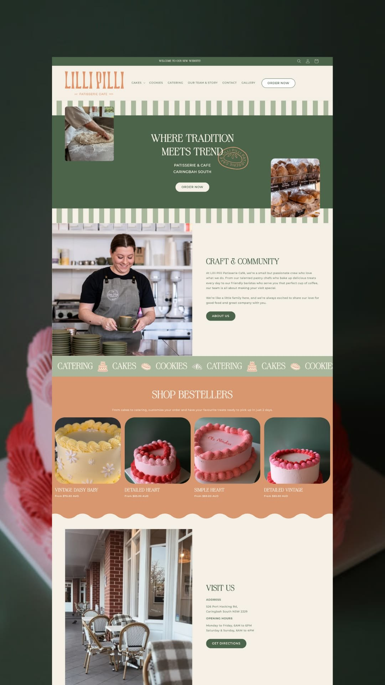

# 06 · Lilli Pilli Patisserie Café

| | |
|---|---|
| Pin | [pinterest.com/pin/586101339056167776](https://www.pinterest.com/pin/586101339056167776/) |
| Original | [Behance: User Flows That Convert (Lilli Pilli Patisserie Café, Shopify)](https://www.behance.net/gallery/251337981/User-Flows-That-Convert/?lilli-pilli-patisserie-cafe-shopify-website-design) |
| What it is | A patisserie café homepage in forest green, sage, peach and cream |
| Image | [`pinterest/board/06-lilli-pilli-patisserie.jpg`](../../../pinterest/board/06-lilli-pilli-patisserie.jpg) |
| Picked for | Hero (alternate: band with floating photos), **Visit us** split (Find us alternate), marquee with icons, wave edge, bestseller row |

View the pin

## Layout

- **Frame.** A desktop homepage on a dark presentation ground with a blurred cake behind.
- **Grid.** Centered hero; 50/50 splits for "Craft & community" and "Visit us"; 4-up product row.
- **Rhythm.** Sage stripe bands bracket the hero; a ribbon and a wave edge frame the product section. Each section has one solid color.

## Sections, top to bottom

| # | Section | Layout | Components | Colors |
|---|---|---|---|---|
| 1 | Announcement | Thin green bar, centered message, search, account and cart icons right | Announcement bar | Forest green |
| 2 | Nav | Tall condensed serif logo left with a small subline; caps links (one with a dropdown); outlined pill "Order now" right | Bar nav, outline pill | Cream, peach logo |
| 3 | Hero | Sage/cream stripes above and below a solid green panel. Centered serif caps headline, a round stamp logo overlapping the headline's end, 2 lines of small caps, cream pill CTA. Two rounded photos float off the panel's corners (top-left and bottom-right) | Stripe-framed band, floating photos, stamp | Forest green, sage stripes |
| 4 | Craft & community | Full-bleed photo left, text right: serif caps title, 2 paragraphs, green pill | Split about | Cream |
| 5 | Ribbon | Sage marquee of serif caps words (CATERING, CAKES, COOKIES) with small line icons of a cake, cookie and croissant between them | Marquee with icons | Sage |
| 6 | Shop bestsellers | Peach band, centered serif caps title and one line, 4 cards: rounded photo, serif caps name, small price. Wave edge at the bottom | Product card, wave edge | Peach |
| 7 | Visit us | Photo left (café front), text right: title, address, opening hours, green pill "Get directions" | Visit split | Cream |

The pin's description also mentions a cake customisation tool and a visual color picker. They aren't visible in the pin image, so they're noted here only as an idea for a future "Build your cake" flow.

## Components

### Band hero with floating photos (section 3)
- A solid panel between two patterned strips; two photos overlap the panel's edges diagonally; the headline stays centered and short.
- **Bakes by Mom.** `Hero variant="band"`: baby blue stripes above and below a cherry or blue panel, two photos (a cake and Mom's hands) floating at the corners, a `Seal` overlapping the headline.

### Ribbon with icons (section 5)
- Category words separated by small line icons instead of dots.
- **Bakes by Mom.** `Marquee` items with `Doodle` separators: CAKES ✿ COOKIES ✿ PIES ✿ BREADS.

### Visit us split (section 7)
- Photo on one side; address and hours as labelled blocks; one action.
- **Bakes by Mom.** Alternate to the weekly schedule ([15](./15-nectar-candy-cart.md)) when there's a fixed pick-up spot: "Pick up from Mom's porch", address, hours, "Get directions".

### Wave edge (section 6)
- Soft, regular waves ending a colored band.
- **Bakes by Mom.** `EdgeDivider shape="wave"`.

## Colors measured

| Swatch | Hex | Where | Bakes by Mom token |
|---|---|---|---|
| Forest green | `#505f4b` area | Hero panel, buttons | Left out (not in the palette) |
| Peach | `#d59670` | Product band, logo | Left out |
| Cream | `#f6f0e6` | Page | `beige-50` |
| Cherry-red cake | `#953734` | Cake photos | Matches `cherry-700` in spirit |

## Type

| Role in the pin | Look | Bakes by Mom font |
|---|---|---|
| Logo | Tall condensed serif | Not carried over |
| Headlines | High-contrast serif caps | Fraunces at high optical size |
| Labels | Small caps sans | DM Sans uppercase |

## Take

- The band hero with floating photos, as an alternate to the main hero.
- Icons as marquee separators.
- The Visit us split and the wave edge.

## Leave

- The forest green and peach. Same layouts, recolored in blue, pink and cherry.
- All-caps headlines longer than five words.
