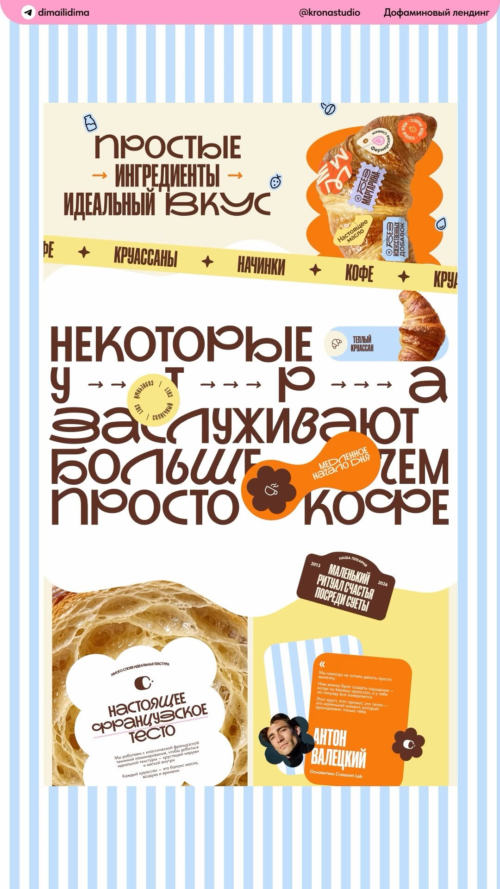

# 07 · Croissant Lab "dopamine" landing page

| | |
|---|---|
| Pin | [pinterest.com/pin/586101339056167775](https://www.pinterest.com/pin/586101339056167775/) |
| Original | Uploaded by the pinner; studio credit in the image: @kronastudio (Telegram @dimailidima) |
| What it is | A loud, joyful bakery landing page in Russian: blue stripes, cocoa display type, butter and orange stickers |
| Image | [`pinterest/board/07-croissant-lab-landing.jpg`](../../../pinterest/board/07-croissant-lab-landing.jpg) |
| Picked for | Hero (alternate: sticker cluster), tilted ribbon, founder quote card, cloud text card, kinetic headline |

View the pin

The pin's caption calls it a "dopamine landing": lots of air, sweet chaos, typography with character and visuals you want to eat with your eyes.

## Layout

- **Frame.** One long page on a baby-blue and white vertical stripe ground, with a pink header bar carrying the credits.
- **Grid.** Full-width stacked blocks. The hero is a 55/45 split; the bottom is a 50/50 split.
- **Rhythm.** Huge type and stickers do the work; there are almost no rules or cards. A cloud-shaped edge joins the headline block to the split below.

## Sections, top to bottom

Translations are given in quotes.

| # | Section | Layout | Components | Colors |
|---|---|---|---|---|
| 1 | Hero | Left: 3-line cocoa display headline with arrows, "Simple → ingredients → perfect taste". Right: a croissant photo on an orange blob, covered in stickers: a perforated stamp ("no margarine"), round badges ("farmers' eggs", "no artificial additives"), a label ("real butter"). Tiny line icons (milk bottle, strawberry, coffee bean, drop) float around | Display headline, sticker cluster, cutout photo | Cream `#f8f3e0`, cocoa `#643725`, orange |
| 2 | Ribbon | A butter ribbon tilted about 3°, crossing the page: "Croissants ✦ Fillings ✦ Coffee" | Tilted marquee | Butter `#f2db87` |
| 3 | Kinetic headline | "Some mornings deserve more than just coffee", with the letters of "mornings" spread out by arrows. Inline: a pill holding a croissant photo and "warm croissant", a round badge "sunny light", an orange blob sticker "a slow start to the day" with a flower icon | Kinetic type, inline photo pill, badges | White, cocoa |
| 4 | Craft split | Left: crumb photo with a cloud-shaped white card ("Many layers, perfect texture. Real French dough") with a wavy underline. Right: butter panel with a cocoa tag-shaped badge ("Our bakery 2013–2026. A small ritual of happiness amid the bustle") and a founder quote card: orange card layered on a blue-stripe card, flower-shaped avatar, name in display type ("Anton Valetsky, founder of Croissant Lab") | Cloud card, tag badge, quote card with flower avatar | Butter, cocoa, blue stripes |

## Components

### Sticker cluster on a cutout photo (section 1)
- A product photo cut out from its background, sitting on a blob shape, with 4–6 overlapping stickers of different shapes (stamp, circle, label), each saying one ingredient promise.
- **Bakes by Mom.** Hero alternate: a cutout cake on a pink blob with stickers "real butter", "baked this morning", "no shortcuts", "Mom approved". Uses `Seal`, `Badge shape="tape"`, `Ticket variant="stamp"`.

### Tilted ribbon (section 2)
- A single marquee rotated a few degrees so it crosses the section boundary.
- **Bakes by Mom.** `Marquee tilt` in butter or pink.

### Founder quote card (section 4)
- A colored card stacked on a striped card, quote mark, short quote, flower-shaped avatar breaking the edge, name in display type and role in small text.
- **Bakes by Mom.** Testimonial or "a note from Mom" card: pink card on blue stripes, avatar in the `flower` photo frame.

### Cloud text card (section 4)
- A white cloud shape over a photo holding a short label, title and wavy-underlined word.
- **Bakes by Mom.** `Card shape="cloud"` for one claim over a texture photo ("Laminated by hand, 27 layers").

### Tag badge (section 4)
- A dark tag shape with years on the sides and a 3-line message.
- **Bakes by Mom.** `PriceTag shape="tag"` reused for "Since 1998" moments.

## Colors measured

| Swatch | Hex | Where | Bakes by Mom token |
|---|---|---|---|
| Stripe blue | `#c1defb` | Background stripes | `blue-200` (slightly calmer) |
| Cocoa | `#643725` | Display type, tag | `brown-700` (anchor) |
| Butter | `#f2db87` | Ribbon, right panel | `butter-300` (anchor) |
| Cream | `#f8f3e0` | Hero card | `beige-100` |
| Orange | `#f47c15` | Blobs, quote card | Left out |

## Type

| Role in the pin | Look | Bakes by Mom font |
|---|---|---|
| Display | Characterful retro display with swashes | Bubble display for single words; Fraunces for headlines |
| Labels, ribbon | Condensed bold sans caps | DM Sans uppercase, bold |
| Body | Plain sans | DM Sans |

## Take

- Sticker clusters on a cutout product.
- A tilted ribbon crossing a boundary.
- The founder quote card with a flower avatar.
- Cloud-shaped text cards.

## Leave

- Orange. Recolor blobs and the quote card pink or cherry.
- Spreading letters of one word across a line; it breaks screen-reader pronunciation. If used, render the word normally for assistive tech and space it visually with CSS.
