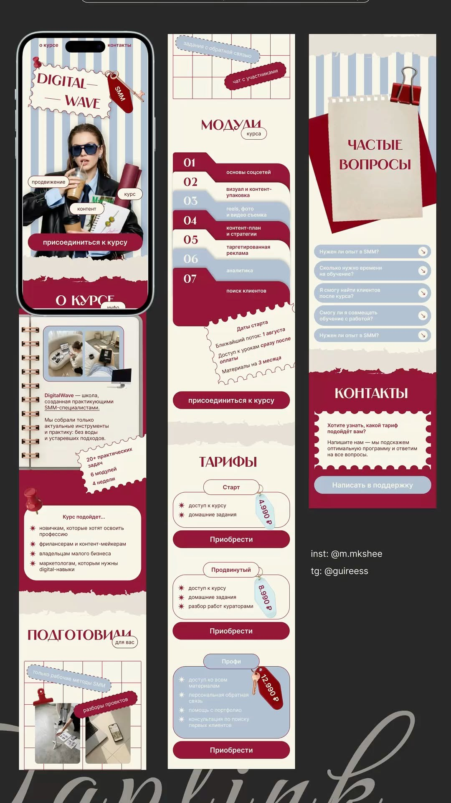

# 08 · Digital Wave, taplink for an SMM course

| | |
|---|---|
| Pin | [pinterest.com/pin/586101339056167773](https://www.pinterest.com/pin/586101339056167773/) |
| Original | Uploaded by the pinner; designer credits in the image: inst @m.mkshee, tg @guireess |
| What it is | Three mobile link-in-bio pages in cherry, dusty blue and cream, built from stationery: stamps, torn paper, folder tabs, key tags, binder clips |
| Image | [`pinterest/board/08-digital-wave-taplink.jpg`](../../../pinterest/board/08-digital-wave-taplink.jpg) |
| Picked for | **Chatbot** (support card and pill rows), **Pricing / custom cakes** (key-tag cards), Process (alternate: numbered folder tabs), FAQ (alternate: pill rows), torn edges |

View the pin

The pages are in Russian; translations are given in quotes.

## Layout

- **Frame.** Three tall mobile pages side by side on a dark ground; one inside a phone mockup.
- **Grid.** Single column, about 24px side margins, full-bleed bands for color changes.
- **Rhythm.** Torn-paper edges between every cherry and cream band; grid-paper areas for "workbook" content.

## Sections, top to bottom

| # | Section | Layout | Components | Colors |
|---|---|---|---|---|
| 1 | Hero | Blue/cream stripes. A perforated stamp-edged card with the cherry serif caps title "DIGITAL — WAVE", a key on a cherry tag ("SMM"), a pushpin. Cutout photo of a person with floating pill labels ("promotion", "content", "course"). Full-width cherry pill CTA ("join the course") | Stamp card, key tag, pill labels, pill button | Dusty blue `#b4c3d1`, cream, cherry `#941939` |
| 2 | About the course | Torn edge into a cherry band; a spiral notebook card with photos and text; a stamp-edged note with stats ("20+ tasks, 6 modules, 4 weeks") | Torn edge, notebook card, stamp note | Cherry, cream |
| 3 | Who it's for | Pushpin on a rounded card with an asterisk-bullet list | List card | Cream |
| 4 | Prepared for you | Serif caps title with a small outlined pill; a grid-paper area with dashed-outline pill labels, a binder clip and two photos | Grid paper, dashed pills | Cream, cherry grid lines |
| 5 | Modules | Grid paper header with pills. Title "MODULES" + pill "of the course". 7 stacked folder tabs numbered 01–07, alternating cherry, cream and blue, each tab overlapping the one below. Then a stamp-edged card with start dates | Folder-tab list, stamp card | Cherry, blue, cream |
| 6 | Pricing | 3 outlined cards. Each: a pill tab title sitting on the top edge, an asterisk list, a hanging key-tag price (acrylic blue or cherry), a full-width cherry buy button. The top plan's card is filled blue | Pricing card, key-tag price | Cream, blue, cherry |
| 7 | FAQ | A torn sheet of paper held by a red binder clip, "FREQUENT QUESTIONS", over a rotated cherry square. Below: blue pill rows, each with a question and a small arrow in a circle | Clip note, pill FAQ rows | Blue `#b1c2d2`, cherry |
| 8 | Contacts | Cherry band with torn edge; a stamp-edged cream card ("Want to know which plan suits you? Write to us and we'll suggest the right program and answer all your questions") and a blue pill button ("Write to support") | Support prompt card | Cherry, cream, blue |

## Components

### Support prompt card (section 8)
- A stamp-edged card with a 2-sentence invitation to ask a question, followed by one soft button.
- **Bakes by Mom.** The heart of the **chatbot**: the chat panel opens on this card ("Not sure what to order? Ask Mom. We'll help you pick a cake and answer anything about allergies, dates or delivery") followed by quick questions.

### Pill rows with arrow circles (section 7)
- Full-width rounded pills, question text left, a small circle with an arrow right.
- **Bakes by Mom.** Chatbot quick replies and an alternate FAQ style (`Accordion variant="pills"`).

### Key-tag pricing card (section 6)
- Outlined card, pill title tab on the top border, checklist, a key-tag price hanging off the top-right corner, a full-width button.
- **Bakes by Mom.** Custom cake packages ("Little cake", "Party cake", "Celebration tier") using `PriceTag shape="tag"` and `Button fullWidth`.

### Numbered folder tabs (section 5)
- Each item is a folder tab: a number on the tab, text on the body; tabs overlap downward; colors alternate.
- **Bakes by Mom.** `StepList variant="tabs"` for a longer process like "Planning your celebration cake" (7 steps).

### Torn edge, stamp edge, binder clip
- Torn paper between bands; perforated stamp edges on notes; a clip holding a note.
- **Bakes by Mom.** `EdgeDivider shape="torn"`, `Ticket variant="stamp"`; the clip is a doodle.

## Colors measured

| Swatch | Hex | Where | Bakes by Mom token |
|---|---|---|---|
| Cherry | `#941939` | Bands, tabs, buttons, title | `cherry-700` (anchor) |
| Deep cherry | `#7f0615` | Shadows, key tag | `cherry-800` |
| Dusty blue | `#b4c3d1` / `#b1c2d2` | Stripes, tabs, FAQ pills | Between `blue-200` and `blue-300` |
| Cream | `#f7f4e7` | Paper | `beige-50` |

## Type

| Role in the pin | Look | Bakes by Mom font |
|---|---|---|
| Titles | High-contrast serif caps | Fraunces |
| Body, buttons, pills | Geometric sans | DM Sans |

## Take

- The support prompt and pill rows as the chatbot's look.
- Key-tag pricing cards for custom cake packages.
- Numbered folder tabs for long processes.
- Torn and stamp edges.

## Leave

- Long all-caps serif titles; keep to one or two words.
- Grid paper behind body text; keep it behind labels and photos only.
