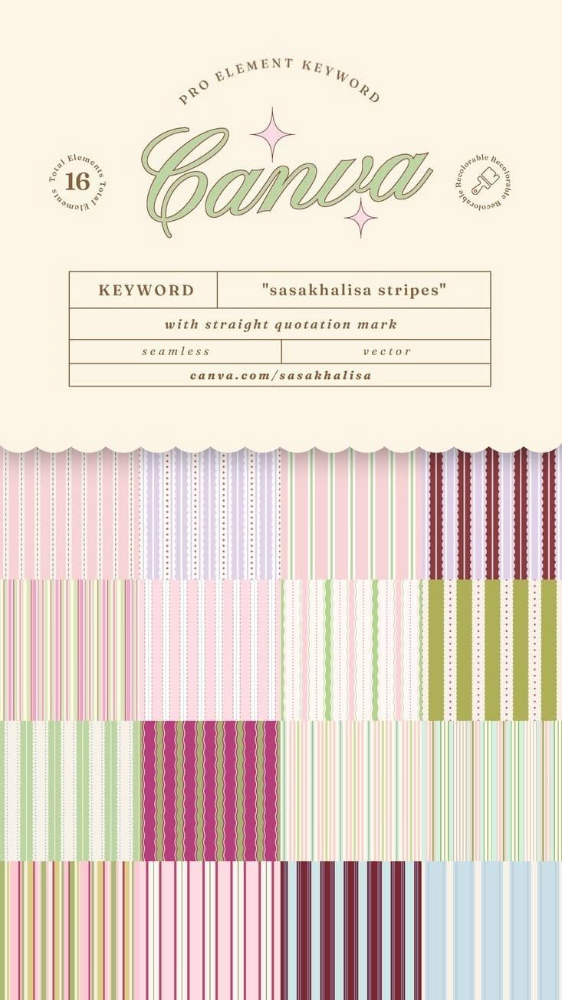

# 09 · Sasa Khalisa pastel seamless stripes

| | |
|---|---|
| Pin | [pinterest.com/pin/586101339056167753](https://www.pinterest.com/pin/586101339056167753/) |
| Original | [Payhip: Canva elements, keyword "sasakhalisa stripes"](https://payhip.com/CanvaWebDesignIdeas/blog/news/70-downloadable-designs-master-canva-creativity/?canva-elements-keyword-pastel-seamless-stripes) |
| What it is | A sheet of 16 seamless stripe patterns for Canva, with a cream header |
| Image | [`pinterest/board/09-sasakhalisa-pastel-stripes.jpg`](../../../pinterest/board/09-sasakhalisa-pastel-stripes.jpg) |
| Picked for | **Pattern library** (all stripe variants), header ornaments (arc text, circle badges, scalloped edge) |

View the pin

## Layout

- **Header.** Cream panel: an arc of spaced caps ("PRO ELEMENT KEYWORD") over a big script word with two pink sparkles; small circular text badges left and right; a ruled keyword table. A scalloped edge ends the header.
- **Swatches.** A 4 × 4 grid of stripe tiles, no gaps.

## The stripe vocabulary

Reading the 16 tiles, the stripes fall into six kinds. These become the variants of `PatternSurface`.

| Kind | What it looks like | Tiles | Bakes by Mom pattern |
|---|---|---|---|
| Plain stripe | Equal-width bands, two colors | Baby blue and cream (bottom right), pink and white | `stripes` |
| Pinstripe | Thin lines on a wide ground | Pink pinstripe, sage pinstripe | `pinstripe` |
| Dotted rule | Stripes with a dotted line running between them | Pink with dots, lilac with dots | `stripes-dotted` |
| Wavy stripe | Stripes with a wavy (sine) edge | Magenta and pink, sage and cream | `stripes-wavy` |
| Scalloped rule | Thin lines with a scalloped edge | Burgundy and lilac, white scallops on lilac | `stripes-scalloped` |
| Candy stripe | Many colors in a repeating sequence of widths | Multi-color pastel tiles | `candy` |

## Colors on the sheet

| Swatch | Approx. | Bakes by Mom token |
|---|---|---|
| Cream header | `#fcf5e6` | `beige-50` |
| Pink | `#f4d3d5` / `#fadfe2` | `pink-200` / `pink-100` |
| Baby blue | `#cce0e5` | `blue-200` area |
| Burgundy | `#934560` area | `cherry-700` area |
| Sage, lilac, olive, magenta | — | Not used (outside the palette) |

## Header ornaments

- **Arc text.** Spaced caps on an arc above a word. Bakes by Mom uses it in the `Orbit` and on seals.
- **Circular badges.** Small round text badges with a number or icon in the middle. Same `Seal` component.
- **Scalloped edge** under the header, same as the board-wide `EdgeDivider shape="scallop"`.

## Take

- All six stripe kinds as pattern variants, recolored to baby blue, pink, cherry and beige.
- Pairing a stripe tile with a scalloped edge.

## Leave

- Sage, lilac and magenta tiles.
- Multi-color candy stripes behind text; use them only on edges, ribbons and frames.
