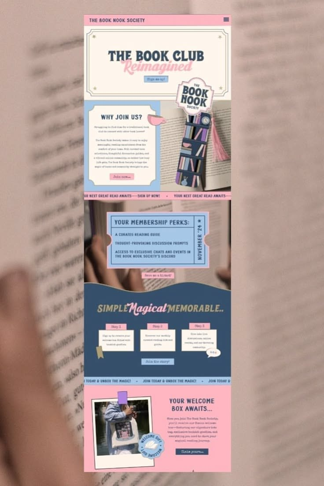

# 10 · The Book Nook Society

| | |
|---|---|
| Pin | [pinterest.com/pin/586101339056167748](https://www.pinterest.com/pin/586101339056167748/) |
| Original | [Instagram: @fylona.by](https://www.instagram.com/fylona.by/) |
| What it is | A mobile book-club site with ticket graphics, seals and pastel blocks in pink, baby blue and navy |
| Image | [`pinterest/board/10-book-nook-society.jpg`](../../../pinterest/board/10-book-nook-society.jpg) |
| Picked for | **Bake Club** (ticket and welcome-box pieces), seal sticker, tabbed step cards, polaroid with seal, chatbot launcher seal |

View the pin

## Layout

- **Frame.** One mobile page over a blurred photo of a book.
- **Grid.** Single column; the "Why join us?" block is a 50/50 split even on mobile.
- **Rhythm.** Thin marquee ribbons between every section; one navy band with a wave top for contrast.

## Sections, top to bottom

| # | Section | Layout | Components | Colors |
|---|---|---|---|---|
| 1 | Top bar | Pink bar: caps logo left, menu icon right | Mobile header | Pink `#fab7c2` |
| 2 | Hero | A cream ticket with a double ruled frame and stars in the corners. Heavy retro title "THE BOOK CLUB" with a pink script word "Reimagined" overlapping it. Small blue button "Sign me up!" | Ticket frame, heavy + script lockup | Cream, navy, pink |
| 3 | Why join us? | Left: blue card with outline, cup icon, title, typewriter body, pink button. Right: photo of a bookmark with a scalloped seal sticker ("THE BOOK NOOK SOCIETY") overlapping its top | Split card, seal sticker | Blue `#a8c3e0`, pink |
| 4 | Ribbon | Pink marquee "YOUR NEXT GREAT READ AWAITS — SIGN UP NOW!" | Marquee | Pink |
| 5 | Membership perks | Over a photo: a blue ticket with notched sides and a stub; the stub has the date "NOVEMBER '24" set vertically; 3-line list. Small pink button "Save a ticket!" | Ticket with stub | Blue, pink |
| 6 | Simple. Magical. Memorable. | Navy band with a wave top. Title mixing heavy slab and pink script. 3 step cards: small pink tab label ("Step 1") on top of a cream paper card, a bookmark ribbon on one, a speech bubble on another. Blue button | Tabbed step cards | Navy `#3a5067`, pink, cream |
| 7 | Ribbon | Blue marquee "JOIN TODAY & UNBOX THE MAGIC!" | Marquee | Blue |
| 8 | Welcome box | Pink band: polaroid with purple tape (tote bag photo) and a round seal "WELCOME GIFT" overlapping its corner; text right: title, paragraph, navy button "Claim yours" | Polaroid, seal | Pink, navy |

## Components

### Ticket with stub (section 5)
- Notched sides, a perforation line before the stub, vertical text on the stub, a list on the body.
- **Bakes by Mom.** `Ticket` for the Bake Club card ("BAKE CLUB · MEMBER PERKS: a monthly treat box, first pick of holiday orders, Mom's recipe card") with the month on the stub.

### Seal sticker (sections 3 and 8)
- Scalloped or round badge with ring text, overlapping a photo's corner at a slight angle.
- **Bakes by Mom.** `Seal`; also the **chatbot launcher**: a round seal "ASK MOM • ASK MOM •" with a heart in the middle, fixed bottom-right.

### Heavy + script title lockup (sections 2 and 6)
- A heavy, upright word with a script word overlapping or following it in a contrasting color.
- **Bakes by Mom.** `SectionHeading` with `<em>` rendered in script, e.g. "The Bake *Club*".

### Tabbed step cards (section 6)
- Paper cards with a small colored tab label on the top edge.
- **Bakes by Mom.** Bake Club "How it works": Step 1 Sign up · Step 2 Pick your treats · Step 3 Unbox on the 1st.

## Colors measured

| Swatch | Hex | Where | Bakes by Mom token |
|---|---|---|---|
| Navy | `#3a5067` | Wave band, buttons, type | `blue-700` (anchor) |
| Pink | `#fab7c2` | Top bar, ribbons, script | `pink-300` (calmer) |
| Baby blue | `#a8c3e0` | Cards, ticket, ribbon | `blue-300` |
| Cream | `#fcf5ec` | Ticket, cards | `beige-50` |

## Type

| Role in the pin | Look | Bakes by Mom font |
|---|---|---|
| Titles | Heavy retro slab caps | Fraunces Black (soft) |
| Accent word | Pink bouncy script | Pinyon Script |
| Body | Typewriter | DM Sans (the typewriter isn't carried over) |

## Take

- Ticket with stub for club perks.
- Seals overlapping photo corners; the chatbot launcher.
- Tabbed step cards for a short club process.
- Navy (`blue-700`) as the one dark blue band.

## Leave

- Typewriter body text at small sizes on photos.
- Text placed directly over busy photos without a card.
