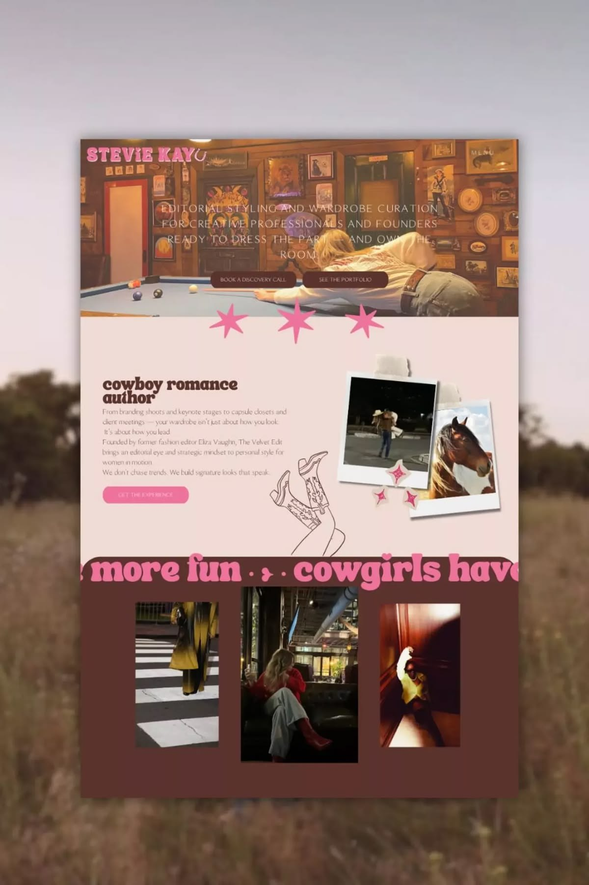

# 11 · Stevie Kay, Showit website

| | |
|---|---|
| Pin | [pinterest.com/pin/586101339056167738](https://www.pinterest.com/pin/586101339056167738/) |
| Original | [Payhip: Elevate your brand with a custom 5-page Showit website](https://payhip.com/CanvaWebDesignIdeas/blog/news/70-downloadable-designs-master-canva-creativity/?elevate-your-brand-with-a-custom) |
| What it is | A photo-led personal brand site: warm interior hero, blush intro with taped polaroids, cocoa gallery band with a bubbly pink marquee |
| Image | [`pinterest/board/11-stevie-kay-showit.jpg`](../../../pinterest/board/11-stevie-kay-showit.jpg) |
| Picked for | Gallery (alternate: trio on cocoa), bubble marquee, polaroid cluster, star divider, full-photo hero (alternate) |

View the pin

## Layout

- **Frame.** A desktop page over a blurred field photo.
- **Grid.** Full-bleed photo hero; 60/40 split intro; 3-up gallery with a bigger center image.
- **Rhythm.** Three big pink stars sit across the seam between the hero and the intro; a line-art illustration bridges the intro and the gallery band.

## Sections, top to bottom

| # | Section | Layout | Components | Colors |
|---|---|---|---|---|
| 1 | Hero | Full-bleed warm photo. Pink bubbly logo top-left. Centered wide-tracked light serif caps tagline over the photo, 2 cocoa pill buttons | Photo hero, overlay text, pill buttons | Photo, cocoa buttons |
| 2 | Star seam | Three hot-pink 4-point stars overlapping the bottom edge of the hero | Doodle divider | Hot pink |
| 3 | Intro | Blush band. Left: bold retro serif title in lowercase ("cowboy romance author"), paragraph, pink pill. Right: two taped polaroids overlapping, small sparkle stickers. A line-art boots illustration hangs below | Polaroid cluster, line illustration | Blush `#f0dbd5`, cocoa type |
| 4 | Gallery band | Cocoa band. Across the top, a bubbly pink headline runs like a marquee ("cowgirls have more fun · ✦ ·"). Three photos in a row, the middle one larger | Bubble marquee, trio gallery | Cocoa `#57362c`, pink |

## Components

### Trio gallery on cocoa (section 4)
- Three photos, center taller, evenly spaced on a dark band, with a big bubbly marquee across the top.
- **Bakes by Mom.** `Gallery variant="trio"` on a cocoa band, marquee "fresh from the oven · ✦ ·" in the bubble font and pink. Good for a short "This week in the kitchen" strip.

### Taped polaroid cluster (section 3)
- Two polaroids at different angles, washi tape at the top, small sparkle stickers.
- **Bakes by Mom.** `Polaroid` pairs in the About section and on the custom cakes page.

### Star seam (section 2)
- Oversized doodles placed across a section boundary.
- **Bakes by Mom.** `Doodle name="sparkle"` ×3 in cherry or pink across the hero's bottom edge.

### Photo hero with overlay text (section 1)
- A full-bleed photo carries the brand; the copy sits over it.
- **Bakes by Mom.** Alternate hero only when the photo has a calm area; add a cocoa scrim behind the text to keep 4.5:1.

## Colors measured

| Swatch | Hex | Where | Bakes by Mom token |
|---|---|---|---|
| Cocoa | `#57362c` | Buttons, gallery band, title | `brown-700` (anchor) |
| Blush | `#f0dbd5` | Intro band | `pink-200` area |
| Hot pink | `#e77898` | Stars, logo, marquee | Not used as is; `pink-400`/`cherry-400` for doodles |

## Type

| Role in the pin | Look | Bakes by Mom font |
|---|---|---|
| Logo, marquee | Bubbly retro display | Bubble display |
| Intro title | Bold, soft retro serif | Fraunces Black with SOFT 100 |
| Tagline | Wide-tracked light serif caps | Fraunces light, uppercase, tracked |

## Take

- The trio gallery on cocoa with a bubble marquee.
- Taped polaroids.
- Doodles crossing a seam.

## Leave

- Light text directly over a busy photo; it fails contrast in the pin.
- Hot pink as a brand color.
