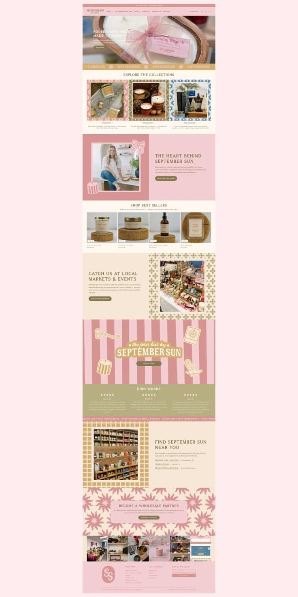

# 12 · September Sun Candle Co.

| | |
|---|---|
| Pin | [pinterest.com/pin/586101339056167737](https://www.pinterest.com/pin/586101339056167737/) |
| Original | [mojunsh.com](https://mojunsh.com/) |
| What it is | A full Shopify homepage for a candle maker in blush, rose, mustard and olive, built from patterned frames |
| Image | [`pinterest/board/12-september-sun-candles.jpg`](../../../pinterest/board/12-september-sun-candles.jpg) |
| Picked for | **Find us: markets and stockists** (alternate), collection cards in patterned frames, Instagram strip (gallery alternate), catering / wholesale call to action, banner with stickers |

View the pin

## Layout

- **Frame.** A complete desktop homepage, scaled down, on a blush ground.
- **Grid.** Alternates centered rows (collections, best sellers, reviews) with 50/50 splits (about, markets, stockists). 3-up and 4-up card rows.
- **Rhythm.** Patterned frames around photos replace plain borders. Two marquees and a full stripe banner add movement.

## Sections, top to bottom

| # | Section | Layout | Components | Colors |
|---|---|---|---|---|
| 1 | Announcement | Rose bar, one centered line | Announcement bar | Rose `#d39794` |
| 2 | Nav | Blush bar: logo left (serif with a script subline), caps links (Shop, The candle pour bar, Events, Our story, Wholesale, Contact), currency + search + account + cart right | Bar nav | Blush |
| 3 | Hero | Full-width product photo; text left over the photo: serif caps headline ("POURED WITH HEART, MADE TO GLOW"), 2 lines, small olive button | Photo hero | Photo |
| 4 | Ribbon | Mustard marquee with the logo word and small sun icons | Marquee | Mustard |
| 5 | Explore the collections | Serif caps title; 3 photos each in a different patterned frame (pink floral, olive tile, blue tile), caps name with arrow, short text | Patterned photo frame, collection card | Cream, pink, blue |
| 6 | The heart behind | Rose block left with a photo (white frame), a bow doodle and candle doodle; text right on blush: serif caps title, paragraph, olive pill | Split about with doodles | Rose, blush |
| 7 | Shop best sellers | Title, one line, 4 product cards (photo on a wooden stand, small badge, name, price) | Product card | Cream |
| 8 | Markets & events | Text left on beige ("Catch us at local markets & events"), photo right in a patterned frame | Split, patterned frame | Beige |
| 9 | Pour bar banner | Rose and blush wide stripes. Centered arched logo badge ("the pour bar by / SEPTEMBER SUN") with an olive pill "Book now". Four sticker doodles around it: scissors, striped candle, matchbook, cowboy boot | Stripe banner, arched badge, sticker doodles | Rose stripes, mustard |
| 10 | Kind words | Olive band: title, 3 columns each with 5 stars, a name and a quote | Review columns | Olive |
| 11 | Ribbon | Rose marquee "CLEAN NON TOXIC INGREDIENTS • HAND-POURED IN SMALL BATCHES" | Marquee | Rose |
| 12 | Find us near you | Photo in a mustard lattice frame left; text right: title, paragraph, a list of stockists with underlined names and towns | Stockist list, lattice frame | Cream |
| 13 | Wholesale | A rounded pink card centered on a big pink starburst pattern: title, line, olive pill | CTA card on pattern | Pink starburst |
| 14 | Instagram | Strip of 6 square photos edge to edge | Instagram strip | Photos |
| 15 | Footer | Blush band: round monogram logo, 3 link columns (Shop info, Let's connect, Stay in the glow) with a newsletter field | Footer | Blush |

## Components

### Patterned photo frame (sections 5, 8, 12)
- A thick border filled with a small repeating pattern (floral, tile, lattice), a thin inner keyline, the photo inside.
- **Bakes by Mom.** `Polaroid frame="pattern"` with the gingham, dots or stripes pattern; use one per row at most, or one per card in a category row: Cakes (pink gingham), Cookies (beige dots), Breads (blue stripes).

### Stockist / market list (section 12)
- A title, a short line, then a list where each line is a linked place name and a town.
- **Bakes by Mom.** Under the weekly schedule: "Also find Mom's bakes at…" with café names linked to maps.

### Banner with sticker doodles (section 9)
- Wide stripes, one arched badge in the middle, 4 sticker doodles in the corners, one button.
- **Bakes by Mom.** Catering or "Book a baking class" banner: pink stripes, an arched `Seal`-style badge "Mom's Baking Class", doodles of a whisk, rolling pin, cupcake and cherry.

### CTA card on a starburst (section 13)
- A calm card on a loud pattern.
- **Bakes by Mom.** Catering / wholesale: "Cakes for your café?" on a pink pattern.

### Instagram strip (section 14)
- 6 squares edge to edge, no captions.
- **Bakes by Mom.** `Gallery variant="grid"` with a "Follow @bakesbymom" link; each image needs alt text.

## Colors measured

| Swatch | Hex | Where | Bakes by Mom token |
|---|---|---|---|
| Blush | `#ffecee` / `#f2cfd0` | Page, footer, about | `pink-50` / `pink-200` |
| Rose | `#d39794` | Announcement, stripes, about block | `pink-400` |
| Cream | `#f6e7d7` | Sections | `beige-100` |
| Sand | `#beab85` | Lattice frame | `beige-400` (anchor) |
| Mustard, olive | `#b39963` area, `#8d8a54` area | Ribbon, buttons, reviews band | Not used as fills; matcha only for success |

## Type

| Role in the pin | Look | Bakes by Mom font |
|---|---|---|
| Titles | Spaced serif caps | Fraunces uppercase, tracked, for short titles only |
| Logo subline | Small script | Caveat |
| Body | Sans | DM Sans |

## Take

- Patterned frames around photos, one pattern per category.
- The markets and stockist list.
- A sticker banner for catering or classes.
- The Instagram strip.

## Leave

- White text on olive and on rose (the reviews band and buttons fail contrast).
- More than two patterned frames in one view.
