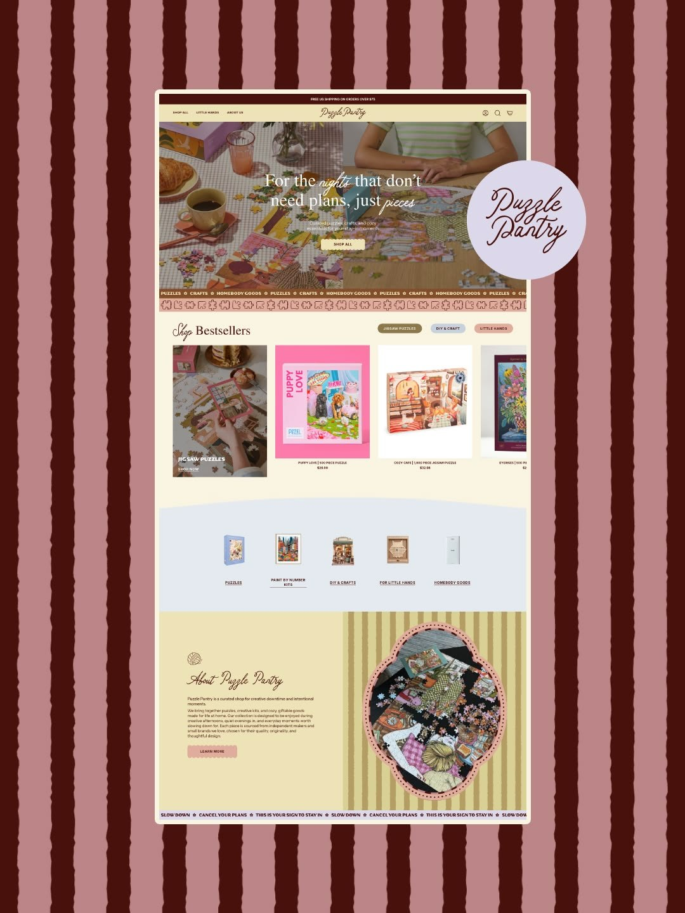

# 13 · Puzzle Pantry

| | |
|---|---|
| Pin | [pinterest.com/pin/586101339056167728](https://www.pinterest.com/pin/586101339056167728/) |
| Original | [Olive St. Studio: Design bursts](https://oliveststudio.com/design-bursts) |
| What it is | A cosy Shopify homepage for puzzles and crafts, with a centered script logo, warm photography and puzzle-piece ribbons |
| Image | [`pinterest/board/13-puzzle-pantry.jpg`](../../../pinterest/board/13-puzzle-pantry.jpg) |
| Picked for | **Announcement bar** (primary), nav icons, filter pills (Menu), category row, cartouche photo frame (About alternate), hero with script words (alternate) |

View the pin

## Layout

- **Frame.** Desktop page in a white rounded frame on rough cocoa/rose stripes, with the logo on a lavender circle sticker overlapping the frame.
- **Grid.** Nav in three zones (links left, logo center, icons right). Product row 4 up with a category tile first. Category icons 5 up. About 50/50.
- **Rhythm.** A puzzle-piece ribbon under the hero and a lavender marquee at the bottom; a curved top edge on the pale blue category band.

## Sections, top to bottom

| # | Section | Layout | Components | Colors |
|---|---|---|---|---|
| 1 | Announcement | Espresso bar, one centered caps line ("FREE US SHIPPING ON ORDERS OVER $75") | Announcement bar | Oxblood `#48110c` |
| 2 | Nav | Butter bar. Small caps links left (Shop all, Little hands, About us), monoline script logo centered, account, search and cart icons right | Three-zone nav | Butter `#ede3b6` |
| 3 | Hero | Full-bleed table photo; centered serif headline with two words in script ("For the *nights* that don't need plans, just *pieces*"); one line; butter pill "Shop all" | Photo hero with script words | Photo, cream type |
| 4 | Ribbon | A row of puzzle-piece shapes with caps words between them (PUZZLES ✿ CRAFTS ✿ HOMEBODY GOODS) | Shape marquee | Rose `#bc8588` |
| 5 | Shop bestsellers | Script "Shop" + serif "Bestsellers" left; 3 filter pills right (olive, blue, pink). Row: a category tile (photo with overlay "JIGSAW PUZZLES / Shop now") then product cards (photo, caps name, price) | Filter pills, category tile, product card | Butter, pills in olive, blue `#e5eaf0`, pink |
| 6 | Categories | Pale blue band with a gently curved top edge; 5 product cut-outs with underlined caps labels | Category row | Pale blue `#e5eaf0` |
| 7 | About | Left: butter panel, yarn-ball icon, script title "About Puzzle Pantry", 2 paragraphs, a pink stamp-edged button "Learn more". Right: hand-drawn olive/butter stripes with an ornate cartouche-shaped photo frame in pink with a stitched dashed border | Split about, cartouche frame, stamp button | Butter, pink, olive stripes |
| 8 | Ribbon | Lavender marquee "SLOW DOWN ✿ CANCEL YOUR PLANS ✿ THIS IS YOUR SIGN TO STAY IN" | Marquee | Lavender |

## Components

### Announcement bar (section 1)
- One short line, centered, small caps, dark band.
- **Bakes by Mom.** `SiteHeader announcement` on cocoa: "Order by Wednesday for Saturday pick-up".

### Three-zone nav (section 2)
- Links left, script logo center, icon buttons right.
- **Bakes by Mom.** Combined with the scalloped pink bar from [15](./15-nectar-candy-cart.md): the icon zone (search, order box with count) comes from here.

### Filter pills (section 5)
- Small rounded pills in different soft colors, right-aligned with the section title.
- **Bakes by Mom.** `FilterChips` for menu categories; pressed state = cherry fill, white text; `aria-pressed` on each.

### Category tile (section 5)
- First item in a product row is a photo tile with the category name and "Shop now" over a dark gradient.
- **Bakes by Mom.** Menu page lead tile: "Celebration cakes / Order now".

### Cartouche photo frame (section 7)
- A decorative scalloped-and-pointed frame shape with a stitched dashed line inside its border.
- **Bakes by Mom.** An extra `Polaroid frame` shape (`cartouche`) for the About alternate or the custom cakes hero.

### Hero with script words (section 3)
- A serif headline where two words switch to script.
- **Bakes by Mom.** The `SectionHeading` rule: `<em>` words render in the script font.

## Colors measured

| Swatch | Hex | Where | Bakes by Mom token |
|---|---|---|---|
| Oxblood | `#48110c` | Announcement, presentation stripes | `brown-900` |
| Butter | `#ede3b6` | Nav, about panel | `butter-200` |
| Pale blue | `#e5eaf0` | Category band | `blue-100` (anchor) |
| Rose | `#bc8588` | Ribbon, presentation stripes | `pink-500` (anchor) |

## Type

| Role in the pin | Look | Bakes by Mom font |
|---|---|---|
| Logo, accent words | Tall monoline script | Caveat for notes, Pinyon Script for headline words |
| Headlines | Editorial serif | Fraunces |
| Labels, ribbons | Small and condensed caps | DM Sans uppercase |

## Take

- Announcement bar and the icon zone of the nav.
- Filter pills and the category tile.
- Script words inside a serif headline.
- The cartouche frame.

## Leave

- Lavender ribbon (recolor to pink or blue).
- Cream text over a busy hero photo without a scrim.
