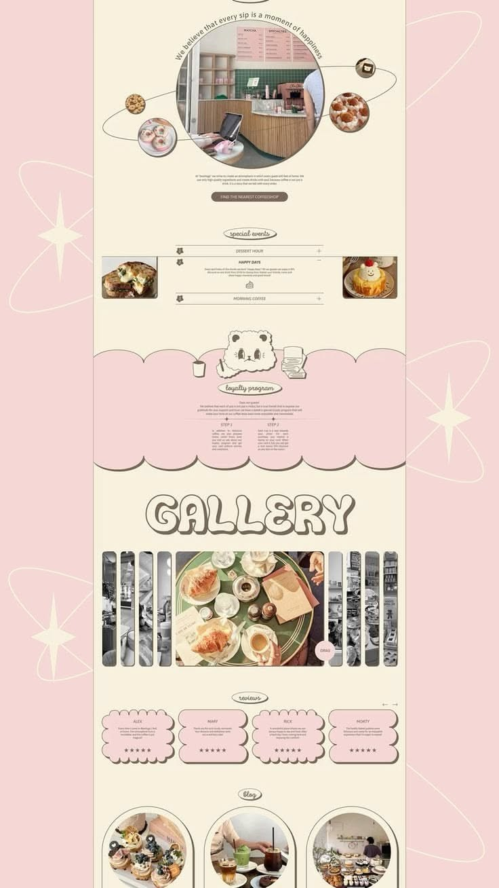

# 14 · Berloga Coffeeshop (second pin of the same design)

| | |
|---|---|
| Pin | [pinterest.com/pin/586101339056167723](https://www.pinterest.com/pin/586101339056167723/) |
| Original | Saved from [Maker Manifest: web design ideas 2025](https://makermanifest.co/DesignWebU/web-design-2025-ideas?web-design-idea-functional) |
| What it is | The same Berloga Coffeeshop page as [pin 01](./01-berloga-coffeeshop.md), re-shared by another site with a slightly different crop |
| Image | [`pinterest/board/14-berloga-coffeeshop-repost.jpg`](../../../pinterest/board/14-berloga-coffeeshop-repost.jpg) |
| Picked for | Same as [01](./01-berloga-coffeeshop.md): Gallery, Reviews, Bake Club band |

View the pin

## What's the same

Every section matches pin 01 one for one: the orbit story block, the special events accordion, the scalloped pink loyalty band with the bear mascot, the bubble `GALLERY` title with the strip gallery, scalloped review cards and arch-framed blog cards. The colors measure the same (`#f5d7d5` pink, `#f9f1de` cream, `#776e60` taupe lines).

## What's different

- The image is narrower (736 × 1308) and slightly lower in resolution.
- The caption frames it as a "functional shopping site" idea, which is a useful signal: the board saved this design twice, so it carries extra weight when choosing references.

## How the system uses that

Because Berloga is the only design on the board saved twice, its signature pieces lead three sections:

| Section | Berloga piece |
|---|---|
| [Gallery](../sections/gallery.md) | Strip gallery with a bubble title |
| [Reviews](../sections/reviews.md) | Scalloped review cards with offset shadows |
| [Bake Club](../sections/bake-club.md) | Scalloped pink band with a mascot on the edge |

For the full breakdown, see [01 · Berloga Coffeeshop](./01-berloga-coffeeshop.md).
