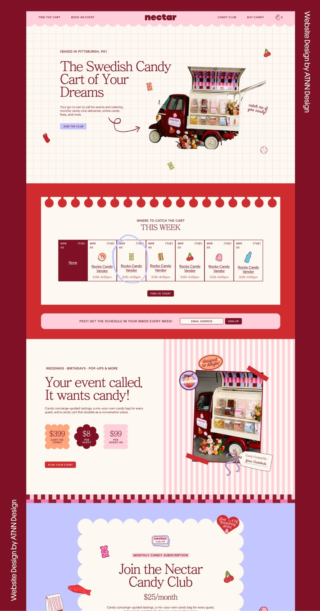

# 15 · Nectar, Swedish candy cart

| | |
|---|---|
| Pin | [pinterest.com/pin/586101339056167722](https://www.pinterest.com/pin/586101339056167722/) |
| Original | [ATNN Design Studio: Nectar](https://www.atnndesign.com/work/nectar) |
| What it is | A playful small-business homepage in cherry, baby pink and cream: grid-paper hero, weekly schedule, event pricing, candy club |
| Image | [`pinterest/board/15-nectar-candy-cart.jpg`](../../../pinterest/board/15-nectar-candy-cart.jpg) |
| Picked for | **Landing page** (primary), **Navbar** (primary), **Hero** (primary), **Find us / weekly schedule** (primary), **Custom cakes pricing** (primary), newsletter bar, Bake Club (alternate) |

View the pin

## Why it leads the landing page

Of the 16 pins, Nectar is the closest match to what Bakes by Mom is: a small, local, family-run food business that sells online, shows up at real places on real days, takes event orders and runs a subscription. It already speaks in cherry, baby pink and cream, and each section answers a question a customer has: *what is this*, *where can I get it this week*, *can you do my party*, *can I get it every month*.

## Layout

- **Frame.** Desktop page on a deep cherry presentation ground, with a vertical credit line.
- **Grid.** 12-column feel: the hero is about 50/50; the schedule is 7 equal columns; the events section is 50/50; the club card is centered at about 70% width.
- **Rhythm.** Every section has its own ground: grid paper, a red band, pink pinstripes, lavender. Edges and borders (scallops, notebook holes, a checker strip, a scalloped card) mark each change.

## Sections, top to bottom

| # | Section | Layout | Components | Colors |
|---|---|---|---|---|
| 1 | Nav | Pink bar with a scalloped bottom edge. Two caps links left (FIND THE CART, BOOK AN EVENT), a bold lowercase wordmark centered, two links right (CANDY CLUB, BUY CANDY) and a bag icon with a count | Split nav around a centered logo, scalloped edge | Pink `#ffcfdb`, cherry type |
| 2 | Hero | Cream grid paper with pink lines. Left: a small caps eyebrow in brackets "(BASED IN PITTSBURGH, PA)", a 3-line serif headline, 2 lines of body, a small pill button. A loopy hand-drawn arrow leads right to a cutout photo of the cart. A handwritten note ("catch me if you candy!") sits beside the photo. Candy doodles (gummy bear, cherries, a lollipop, a swirl) are scattered | Grid-paper hero, cutout photo, hand arrow and note, doodles | Cream `#fbf7f1`, cherry `#801026` |
| 3 | This week | Red band. Inside, a cream card with a row of circles along its top edge (like notebook holes). Caps eyebrow "WHERE TO CATCH THE CART" + serif "THIS WEEK". A 7-column table: each cell has the date and day, a candy icon, the place (underlined link) and the time. The first cell is filled cherry and says "None". A hand-drawn circle highlights one cell. Cherry button "FIND US TODAY" | Weekly schedule, notebook-hole edge | Red `#d02b2f`, cherry `#801026`, cream |
| 4 | Newsletter bar | A pink pill-shaped bar across the red band: "PSST! GET THE SCHEDULE IN YOUR INBOX EVERY WEEK!", an email field and a cherry "SIGN UP" button | Inline newsletter bar | Pink, cherry |
| 5 | Events | Left on cream: caps eyebrow "WEDDINGS · BIRTHDAYS · POP-UPS & MORE", a 2-line serif headline ("Your event called. It wants candy!"), body, three price shapes (a scalloped square "$399 cart fee (3hrs)", a flower "$8 per guest", a cloud "$99 per added hr"), red button "PLAN YOUR EVENT". Right: pink pinstripe panel with a tilted photo of the cart, red tape on two corners, round stickers ("designed to delight!", the logo) and a gift tag with a ribbon ("Candy curated by: your tastebuds") | Price shapes, pinstripe panel, taped photo, stickers, gift tag | Cream, pink pinstripe, cherry, red |
| 6 | Checker border | A strip of cherry, pink and hot-pink checks | Edge divider (checker) | Cherry, pinks |
| 7 | Candy club | Lavender band. A big cream card with a scalloped outline: club logo sticker, a highlighted label "MONTHLY CANDY SUBSCRIPTION", a serif headline "Join the Nectar Candy Club", the price "$25/month", body. A heart sticker ("Just a lil something sweet") and candy doodles around the card | Scalloped card, highlight label, stickers | Lavender `#c4c6ff`, cream, cherry |

## Components

### Split nav around a centered logo, scalloped bottom (section 1)
- Links are split evenly around the wordmark; the bar ends in small scallops; a bag icon with a number sits at the far right.
- **Bakes by Mom.** The main `SiteHeader`: pink bar, "Menu · Custom cakes" left, the Bakes by Mom logo center, "Find us · Bake Club" right, an order-box icon with a count, scalloped bottom edge. The announcement bar from [13](./13-puzzle-pantry.md) sits above it. Below tablet width it collapses to the capsule from [03](./03-emily-jane-author.md) with a menu button.

### Grid-paper hero (section 2)
- **Anatomy.** Eyebrow in brackets → 3-line headline → 2 lines → small button, all left; cutout product photo right; one handwritten note with a loopy arrow pointing from the text toward the photo; 4–6 small doodles scattered with plenty of air.
- **Bakes by Mom.** `Hero variant="paper"`: "(BAKED IN MOM'S KITCHEN, AUSTIN)" eyebrow, "Homemade cakes, *still warm* from Mom's oven", a cutout strawberry cake, note "made with real butter!", doodles of a cherry, heart, sparkle and cupcake.

### Weekly schedule (section 3)
- **Anatomy.** A 7-column grid, one column per day. Each cell: date and day on top, an icon, the place as a link, the time. Days with no stop get a filled cell and "None" (or "Closed").
- **Bakes by Mom.** `WeekSchedule`: "Where to find Mom this week": farmers' market Saturday, porch pick-up Wednesday, café drop Thursday. Built as a real list of days (each cell is a list item with a heading for the day), stacking to 2 columns, then 1, on small screens.

### Price shapes (section 5)
- Three different shapes in three colors, each with a big number and a 2-line label.
- **Bakes by Mom.** `PriceTag` flower, cloud and scalloped square for custom cake pricing: "$45 6-inch cake", "$4 per cupcake", "$15 custom message".

### Taped photo with stickers and a gift tag (section 5)
- Photo tilted a few degrees on a pinstripe ground, tape on two corners, 2 round stickers overlapping, a tag hanging off the bottom corner on a bow.
- **Bakes by Mom.** The custom cakes visual: a celebration cake photo with tape, a "designed to delight" seal and a tag "Baked for: your big day".

### Scalloped club card (section 7)
- A big card whose whole outline is scalloped, centered on a colored band, with stickers breaking its edge.
- **Bakes by Mom.** Bake Club alternate: `Card shape="scallop"` on baby blue.

## Colors measured

| Swatch | Hex | Where | Bakes by Mom token |
|---|---|---|---|
| Bright cherry | `#d02b2f` | Schedule band, event button | `cherry-500` (anchor) |
| Deep cherry | `#801026` | Headlines, buttons, "None" cell | `cherry-800` (anchor) |
| Pink | `#ffcfdb` | Nav, newsletter bar | `pink-300` area |
| Cream | `#fbf7f1` | Grid paper, cards | `beige-50` |
| Lavender | `#c4c6ff` | Club band | Left out; Bake Club uses baby blue |

## Type

| Role in the pin | Look | Bakes by Mom font |
|---|---|---|
| Headlines, prices | Soft high-contrast serif | Fraunces |
| Eyebrows, nav | Small caps sans with tracking | DM Sans uppercase |
| Notes | Casual handwriting | Caveat |
| Wordmark | Bold rounded lowercase | The Bakes by Mom logo |

## Take

- The overall page order: hero → this week → newsletter → events and pricing → club.
- The split nav with a scalloped edge.
- The grid-paper hero with a handwritten note and arrow.
- The weekly schedule.
- Price shapes and the taped photo with stickers.

## Leave

- Lavender and hot pink.
- A hand-drawn circle as the only way to mark "today"; Bakes by Mom also labels it in text ("Today").
