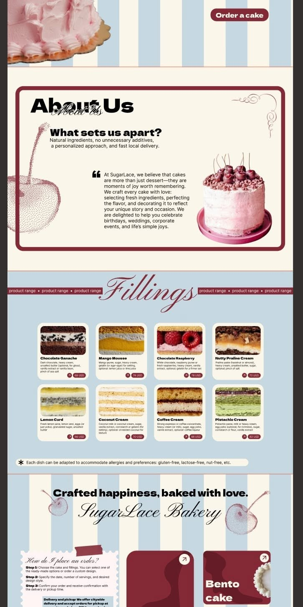

# 16 · SugarLace Bakery

| | |
|---|---|
| Pin | [pinterest.com/pin/586101339056167720](https://www.pinterest.com/pin/586101339056167720/) |
| Original | [mojunsh.com](https://mojunsh.com/) |
| What it is | A vintage-inspired custom cake shop in baby blue, cream and cherry, with halftone cherries and formal script |
| Image | [`pinterest/board/16-sugarlace-bakery.jpg`](../../../pinterest/board/16-sugarlace-bakery.jpg) |
| Picked for | **Menu / products** (primary), About (alternate: outlined card), "How do I order?" card, category tiles, the halftone cherry illustration style, heavy + script title |

View the pin

## Layout

- **Frame.** A desktop page crop on a dark ground; it starts mid-hero.
- **Grid.** About is a framed card with text left and a cake right. Fillings is a 4 × 2 card grid. The bottom is a 1/3 + 2/3 split: an order card and category tiles.
- **Rhythm.** Baby blue and cream stripes open and close the page; a solid baby blue band holds the menu; thin cherry rules sit between bands.

## Sections, top to bottom

| # | Section | Layout | Components | Colors |
|---|---|---|---|---|
| 1 | Hero (partial) | Baby blue and cream vertical stripes; a pink cake cutout at the top-left; a cherry pill "Order a cake" top-right | Stripe hero, cutout, pill button | Blue `#c6d8e2`, cream, cherry |
| 2 | About us | Cream card with a thick cherry outline and big radius. Title: heavy grotesque "About Us" with the same words in formal script overlapping it. A flourish ornament top-right. A halftone cherry illustration bleeds off the left edge. Subhead "What sets us apart?" (heavy), 2 lines, then a quote-mark paragraph. Cake cutout right | Outlined card, heavy + script lockup, halftone illustration | Cream `#faf6ea`, cherry `#842a36` |
| 3 | Fillings | Baby blue band. Huge formal script "Fillings" centered between two cherry ribbons repeating "product range •". A 4 × 2 grid of white rounded cards: a photo of the cake cross-section, bold name, 3–4 lines of ingredients, and bottom-right an arrow in a circle plus a cherry price pill ("68 USD"). A pill note with an asterisk under the grid: "Each dish can be adapted to accommodate allergies and preferences: gluten-free, lactose-free, nut-free, etc." | Section title with ribbons, product card, allergy note | Blue `#c6d8e2`, white cards, cherry pills |
| 4 | Crafted happiness | Blue and cream stripes. Heavy line "Crafted happiness, baked with love." over script "SugarLace Bakery", halftone cherries on both sides | Heavy + script lockup, halftone illustration | Stripes, cocoa type |
| 5 | Order and categories | Left: a stamp-edged cream card with a strip of cherry tape on top, script title "How do I place an order?", 3 bolded steps, and a blue note box about delivery and pickup. Right: big cherry tiles with rounded corners, a darker cherry cake silhouette inside, an arrow circle top-right, and a heavy white label ("Bento cake") | Stamp card with tape, category tile | Cherry `#842a36`, cream, blue |

## Components

### Menu card (section 3)
- **Anatomy.** White card, 16px radius; photo top with its own rounded corners; bold name; ingredients in small text; a footer row with an arrow-circle link and a price pill aligned right.
- **Bakes by Mom.** `ProductCard variant="menu"` on a baby blue band: photo, name, "what's inside" line, price pill in cherry, arrow button "View". The allergy note under the grid becomes a standard `Badge`-style note.

### Section title with ribbons (section 3)
- A huge script word with cherry ribbons on both sides carrying a repeated small caps phrase.
- **Bakes by Mom.** `SectionHeading variant="ribbon"`: "*Menu*" with ribbons "fresh this week •".

### Heavy + script lockup (sections 2 and 4)
- The same word set twice, once in a heavy grotesque and once in formal script, overlapping.
- **Bakes by Mom.** `SectionHeading variant="stamp"` for one moment per page ("About *us*"). Script copy is decorative; the heading text is read once.

### Halftone cherry illustration
- Dotted, print-like cherries in muted cherry red, cropped by the card or the page edge.
- **Bakes by Mom.** The illustration style for big decorative moments (`Doodle name="cherry" style="halftone"`), always `aria-hidden`.

### "How do I place an order?" card (section 5)
- Stamp-edged paper card, tape on top, script title, numbered bold steps, a highlighted note box.
- **Bakes by Mom.** Compact process for the menu page, using `Ticket variant="stamp"`.

### Category tile (section 5)
- A cherry tile with rounded corners, a darker cherry shape inside, a white arrow circle and a heavy white label.
- **Bakes by Mom.** "Bento cakes", "Cupcakes", "Cookie boxes" tiles on the home page.

## Colors measured

| Swatch | Hex | Where | Bakes by Mom token |
|---|---|---|---|
| Baby blue | `#c6d8e2` / `#c7d8e1` | Menu band, stripes | `blue-200` |
| Cherry | `#842a36` / `#7c2932` | Outline, pills, tiles, ribbons | `cherry-700` area |
| Cream | `#faf6ea` | Page, card | `beige-50` |
| White | `#ffffff` area | Menu cards | `paper` `#fffdf6` |
| Pink | cake photos | Cake | `pink-300` |

## Type

| Role in the pin | Look | Bakes by Mom font |
|---|---|---|
| Heavy titles | Wide heavy grotesque | DM Sans at 800–900 |
| Script | Formal copperplate | Pinyon Script |
| Body | Clean sans | DM Sans |

## Take

- The menu card and grid on a baby blue band. It's the closest board match to your palette.
- The script section title with ribbons.
- Halftone cherries as the signature illustration.
- The order card and cherry category tiles.
- The allergy note pattern.

## Leave

- Heavy and script versions of the same word on every section. Once per page.
- Ingredient text below 14px.
